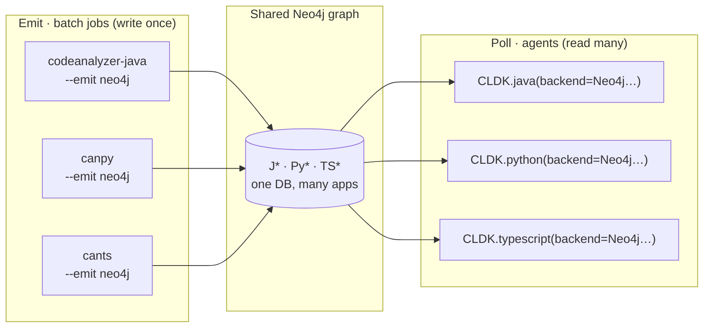

import { Tabs, TabItem, Steps, Aside, LinkCard, CardGrid } from "@astrojs/starlight/components";

In the [default workflow](/quickstart/), CLDK runs the analysis on your machine. You point `CLDK.java(...)` at a project. The backend parses it, and the typed models stay in memory for the life of that object. This model is correct for a single project on a single machine.

It does not fit a fleet. A fleet has hundreds of repositories in several languages, and agents that answer structural questions about any of them at any time. A new analysis on every request wastes work. Every project in memory at once is impossible.

CLDK has a second model for this case. **It splits analysis and querying into two phases that scale independently:**

1. **Emit.** Each `codeanalyzer-*` backend projects its analysis into a **Neo4j property graph** instead of a JSON file. This step is expensive, and you can batch it. Run it once for each project. Then run it incrementally, wherever you have compute.
2. **Poll.** The CLDK SDK connects to that graph as a **read-only Cypher client**. It parses no source at query time. The `analysis` object answers from the graph. This step is cheap, it scales horizontally, and your agents run it.

Every language shares one database. Agents therefore get **multi-lingual, multi-project program analysis** behind the same `analysis` API that they already use.



<Aside type="tip" title="Where this runs">
The two phases are independent processes. The emit jobs usually run on a schedule, in a CI pipeline or a Kubernetes `CronJob`. The agents run as long-lived services that only read. See [Deploy on Kubernetes](/at-scale/kubernetes/) for a concrete topology, with Odoo as the worked example.
</Aside>

## One graph, every language, every project

Each backend writes a **namespaced** label set so multiple languages share a single database without collisions. Java labels are `J*` and `J_*`. Python labels are `Py*` and `PY_*`. TypeScript labels are `TS*` and `TS_*`, plus a few unprefixed labels (`CanNode`, `Application`, `Artifact`, `Package`, and `ConfigKey`):

| Language | App anchor | Module node | Symbol node (merge label) | Call edge |
| --- | --- | --- | --- | --- |
| Java | `:JApplication` | `:JModule` | `:JSymbol` → `:JType` / `:JCallable` / `:JExternal` | `:J_CALLS` |
| Python | `:PyApplication` | `:PyModule` | `:PySymbol` → `:PyClass` / `:PyCallable` / `:PyExternal` | `:PY_CALLS` |
| TypeScript | `:TSApplication` | `:TSModule` | `:CanNode` → `:TSClass` / `:TSCallable` / `:TSExternal` | `:TS_CALLS` |

Within a language, **multiple projects** also coexist. Each backend scopes every node to an application anchor, which `--app-name` identifies. One database can therefore hold `payments-service`, `web-frontend`, and `billing-core` side by side. On the read side, `application_name` selects the one that a query sees. For two Java applications that share files, read the caution in [Writes are idempotent and incremental](/at-scale/#writes-are-idempotent-and-incremental).

**External (phantom) nodes.** All three graphs add external nodes (`:JExternal`, `:PyExternal`, and `:TSExternal`) for call targets *outside* the analyzed app. These targets are third-party libraries, the standard library, the JDK, and Node built-ins. Call edges therefore never dangle.

External nodes carry no `_module`. Their ids start with `can://<app>/@external/`, so each app has its own external nodes. A query can therefore see that an app calls `os.path.join` or `node:crypto.createHash`, even though those are not part of its source.

<Aside type="note" title="Languages supported">
The Neo4j emit and poll path works for **Java, Python, and TypeScript**.
</Aside>

## Phase 1: Emit a graph

Every backend takes the same `--emit neo4j` flag. With this flag, the backends always project the graph at full depth. Do not pass `-a`: `canjv` and `canpy` reject every `-a` value, and `cants` rejects a value above 1. If you set `--neo4j-uri` or the `NEO4J_URI` environment variable, the backend pushes to a live database over Bolt. If you set neither, it writes a self-contained `graph.cypher` snapshot that you load with `cypher-shell`.

The two modes differ in more than destination. The live Bolt push is content-hash incremental: it rewrites only the changed modules. A full run also prunes orphans, but `canpy` and `cants` prune only with `--eager`. The `graph.cypher` snapshot erases and rebuilds the whole subgraph of that application every time you apply it.

The backend also reads the connection values from the `NEO4J_URI`, `NEO4J_USERNAME`, `NEO4J_PASSWORD`, and `NEO4J_DATABASE` environment variables. An explicit flag wins over the environment.

<Tabs syncKey="lang">
  <TabItem label="Java">
    ```bash title="Java → Neo4j (live Bolt push)"
    canjv -i ./payments-service --emit neo4j \
      --app-name payments-service \
      --neo4j-uri bolt://localhost:7687 \
      --neo4j-user neo4j --neo4j-password "$NEO4J_PASSWORD"
    ```

    ```bash title="Java → graph.cypher snapshot (no live DB)"
    canjv -i ./payments-service --emit neo4j -o ./out
    cypher-shell -u neo4j -p "$NEO4J_PASSWORD" < ./out/graph.cypher
    ```
  </TabItem>
  <TabItem label="Python">
    ```bash title="Python → Neo4j (live Bolt push)"
    canpy -i ./billing-core --emit neo4j \
      --app-name billing-core \
      --neo4j-uri bolt://localhost:7687 \
      --neo4j-user neo4j --neo4j-password "$NEO4J_PASSWORD"
    ```

    ```bash title="Python → graph.cypher snapshot"
    canpy -i ./billing-core --emit neo4j -o ./out   # -> ./out/graph.cypher
    cypher-shell -u neo4j -p "$NEO4J_PASSWORD" < ./out/graph.cypher
    ```
  </TabItem>
  <TabItem label="TypeScript">
    ```bash title="TypeScript → Neo4j (live Bolt push)"
    cants -i ./web-frontend --emit neo4j \
      --app-name web-frontend \
      --neo4j-uri bolt://localhost:7687 \
      --neo4j-user neo4j --neo4j-password "$NEO4J_PASSWORD"
    ```

    ```bash title="TypeScript → graph.cypher snapshot"
    cants -i ./web-frontend --emit neo4j -o ./out   # -> ./out/graph.cypher
    cypher-shell -u neo4j -p "$NEO4J_PASSWORD" < ./out/graph.cypher
    ```
  </TabItem>
</Tabs>

<Aside type="caution" title="Load a snapshot">
`cypher-shell` 2026.07.1 runs only on Java 21 or 25. If `JAVA_HOME` points to an older JDK, set it for the load only:

```bash
JAVA_HOME=/path/to/jdk-21 cypher-shell -u neo4j -p "$NEO4J_PASSWORD" < ./out/graph.cypher
```

A load can take several minutes, and it can need a large Neo4j heap. If `cypher-shell` stops with `51N36` (out of memory), raise `server.memory.heap.max_size` in `neo4j.conf`, for example to `4g`. Then restart Neo4j and load the snapshot again.
</Aside>

### Writes are idempotent and incremental

A repeated job is safe and cheap. This is what makes a scheduled fleet practical:

- **Idempotent.** Both writers create the schema constraints and indexes first, then upsert with `MERGE`, never a blind `CREATE`. The same project always produces the same graph.
- **Incremental.** A live Bolt push diffs each module against the graph by content hash. It rewrites **only what changed**. A full run also prunes the modules whose source file is gone. Each writer scopes this prune to its own application. The Java writer prunes on every full run. The Python and TypeScript writers prune only on a full run with `--eager`.
- **Index-backed.** Constraints exist before any `MERGE`, so every upsert is an index seek, not a scan, even as the database grows.

<Aside type="caution" title="Two Java applications in one database">
In codeanalyzer-java 3.3.3, the live Bolt push compares each file with the files of every Java application in the database. If another Java application has a file with the same project-relative path and the same content, the push skips that file. The run still exits with code 0. The analysis of the new application then has no classes from that file. `--eager` does not change this. If two Java applications share files, for example two branches of one project, load each one from a `graph.cypher` snapshot.
</Aside>

### A versioned schema contract

Each backend can emit its graph schema as a machine-readable, version-stamped contract with `--emit schema`. This command needs no project. Each backend also stamps `schema_version` on the `:*Application` node of every graph. A consumer can therefore make sure that the schema is compatible before it queries.

Read it back for each application with `MATCH (a:JApplication {id: 'can://' + $app}) RETURN a.schema_version`. Use `:PyApplication` or `:TSApplication` for the other languages. Match on `id`, because the `:TSApplication` node has no `name` property. Each backend versions its schema on its own, so pin the contract that you generated against. Do not assume one shared version.

```bash title="Export the schema contract"
canjv --emit schema -o ./out/java         # -> ./out/java/schema.neo4j.json
canpy --emit schema -o ./out/python       # -> ./out/python/schema.json
cants --emit schema -o ./out/typescript   # -> ./out/typescript/schema.json
```

## Phase 2: Poll the graph

On the read side, nothing about the `analysis` API changes. You pass a `Neo4jConnectionConfig` as `backend=`, and the SDK selects the read-only Cypher backend by configuration type. `project_path` is **optional** in this mode, because CLDK reads no source. If you give `project_path`, the directory must exist. `application_name` selects the project in the database that the queries see.

<Tabs syncKey="lang">
  <TabItem label="Java">
    ```python title="Query a Java graph"
    from cldk import CLDK
    from cldk.analysis.commons.backend_config import Neo4jConnectionConfig

    analysis = CLDK.java(
        backend=Neo4jConnectionConfig(
            uri="bolt://neo4j:7687",
            username="reader",          # read-only credentials are enough
            password="…",
            application_name="payments-service",
        ),
    )

    classes = analysis.get_classes()      # -> dict[str, JType], straight from the graph
    cg = analysis.get_call_graph()        # -> networkx.DiGraph
    ```
  </TabItem>
  <TabItem label="Python">
    ```python title="Query a Python graph"
    from cldk import CLDK
    from cldk.analysis.commons.backend_config import Neo4jConnectionConfig

    analysis = CLDK.python(
        backend=Neo4jConnectionConfig(
            uri="bolt://neo4j:7687",
            username="reader",
            password="…",
            application_name="billing-core",
        ),
    )

    callers = analysis.get_callers("billing_core.invoice.Invoice", "finalize")
    ```
  </TabItem>
  <TabItem label="TypeScript">
    ```python title="Query a TypeScript graph"
    from cldk import CLDK
    from cldk.analysis.commons.backend_config import Neo4jConnectionConfig

    analysis = CLDK.typescript(
        backend=Neo4jConnectionConfig(
            uri="bolt://neo4j:7687",
            username="reader",
            password="…",
            application_name="web-frontend",
        ),
    )

    cg = analysis.get_call_graph()        # -> networkx.DiGraph
    ```
  </TabItem>
</Tabs>

The `neo4j` driver can print `Received notification from DBMS server` warnings to stderr. The warnings do not stop the run. With cldk 2.0.0 on Commons CLI 1.7.0, the Java sample printed seven warnings. It still returned 75 classes and a call graph with 652 nodes and 1980 edges, the same as the local backend. The `canjv` run that wrote the graph used JDK 17, and with JDK 21 or 25 the call graph has 1976 edges. To hide the warnings, call `logging.getLogger("neo4j.notifications").setLevel(logging.ERROR)` before you build the analysis.

The Neo4j backends (`JNeo4jBackend`, `PyNeo4jBackend`, `TSNeo4jBackend`) give you the **same method surface** as the local backends, with a few documented exceptions. For example, `get_all_comments` and `get_comment_in_file` raise on the Java Neo4j backend, because the graph holds one docstring per declaration and no file-level comments. Most existing query code works without a change. Only the `backend=` argument changes.

<Aside type="caution" title="Known issue in cldk 2.0.0">
In cldk 2.0.0, `CLDK.typescript(backend=Neo4jConnectionConfig(...))` can raise `ValueError: child id is not minted under its parent`. The cause is a module that gives one name to two declarations, for example a type and a namespace. The graph of Zod 4.6.7 has such a module. The factory call raises the error, so no query runs. For these graphs, query [with Cypher](/at-scale/#query-the-graph-directly-with-cypher), or use the local backend.
</Aside>

<Steps>
1. Install the optional driver: `pip install "cldk[neo4j]"`. It installs `neo4j>=5.14,<7`. The driver is an extra, not a core dependency.
2. Point `Neo4jConnectionConfig.uri` at your Bolt endpoint and set `application_name` to the project you want to query.
3. Call the usual `get_classes`, `get_call_graph`, `get_callers`, `get_callees`, and related methods. The graph answers, and CLDK parses no source.
</Steps>

## Query the graph directly with Cypher

The `analysis` API covers the common structural questions. The graph is also a full Neo4j property graph. An agent can reach anything that the API does not model with raw Cypher over the same Bolt endpoint. The label namespacing is the query contract. Scope by the `:*Application` anchor and the language prefix.

**Discover what a shared database holds.** The SDK expects you to know the `application_name` first. If you give neither `application_name` nor `project_path`, the Neo4j backends raise an error. They have no enumeration method. An inventory is therefore its own Cypher query:

```cypher
MATCH (a)
WHERE a:JApplication OR a:PyApplication OR a:TSApplication
RETURN [l IN labels(a) WHERE l IN ['JApplication', 'PyApplication', 'TSApplication']][0] AS language,
       substring(a.id, 6) AS app, a.schema_version
```

**Full-text code search.** Every backend creates a Neo4j full-text index over the `code` of each callable. The Java and Python indexes also cover the `docstring`. Each language names its index differently: `j_code_fts`, `py_code_fts`, and `ts_code_fts`. The CLDK API does not wrap it, so reach it over Bolt:

```cypher
CALL db.index.fulltext.queryNodes('py_code_fts', 'jwt OR authenticate') YIELD node, score
RETURN node.signature, score ORDER BY score DESC LIMIT 20
```

**Java entry points and CRUD.** The Java `analysis` object answers `get_entry_point_methods()` from the graph with no new parse. In cldk 2.0.0, the CRUD accessors (`get_all_crud_operations()` and its create, read, update, and delete variants) raise `CodeanalyzerExecutionException` on both backends. codeanalyzer-java 3.0.1 and newer emit no CRUD operations in schema v2. See the [Java API reference](/reference/python-api/java/).

<Aside type="caution" title="What at-scale means here">
Scale here comes from **architecture**, not from tuning knobs. The parts are an idempotent index-backed `MERGE`, content-hash incrementality, and emit jobs that you can run in parallel. The writers do **not** have a configurable batch size or `PERIODIC COMMIT`.

A **targeted run** (`--target-files` on `cants`, `--file-name` on `canpy`) skips orphan pruning, so only a full run removes deleted files. The Python and TypeScript writers also need `--eager` on that full run. `canjv` rejects `--target-files` under the default `--schema v2`. With `--schema v1`, it writes a legacy graph that CLDK 2.0.0 refuses. Run every Java emit as a full run. Plan your jobs as periodic full runs, with incremental pushes between them.
</Aside>

## See also

<CardGrid>
  <LinkCard title="Deploy on Kubernetes" href="/at-scale/kubernetes/" description="A Job/CronJob emit topology and the Odoo multi-lingual walkthrough." />
  <LinkCard title="codeanalyzer-java" href="/backends/codeanalyzer-java/" description="The backend that emits the J* graph." />
  <LinkCard title="codeanalyzer-python" href="/backends/codeanalyzer-python/" description="The backend that emits the Py* graph." />
  <LinkCard title="codeanalyzer-ts" href="/backends/codeanalyzer-ts/" description="The backend that emits the TS* graph." />
</CardGrid>
