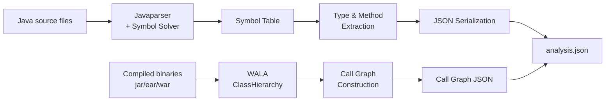

import { Tabs, TabItem, Steps, Aside, LinkCard, CardGrid, FileTree, Badge } from "@astrojs/starlight/components";

The **codeanalyzer-java** backend is the JVM-based static analysis backend for Java in the CLDK Python SDK. It uses WALA (T.J. Watson Libraries for Analysis) for semantic analysis and Javaparser for syntactic extraction. It writes one JSON schema, and the Python SDK deserializes that schema into typed models.

## Overview

codeanalyzer-java is a **standalone JAR tool**. It takes a Java project, or a source string, and writes a JSON graph that contains:

- **Symbol table**: All types (classes, interfaces, enums, records), their fields, methods/constructors, and imports
- **Call graph** (optional, at analysis level 2): Edges between callers and callees, computed by the interprocedural analysis of WALA
- **Type hierarchy**: Extends/implements relationships, nested types, parent-child relationships
- **Comments and Javadoc**: The text and the position of each comment, attached to its entity
- **Entrypoints**: Main methods and framework-identified entrypoints (REST endpoints, Struts actions)

The Python SDK runs this backend, parses the JSON, and wraps it in `JavaAnalysis`. You therefore work with an `analysis` object, not with the backend. The backend is a JAR.

<Badge text="2.0" variant="caution" /> The optional extra `cldk[java]` installs the `codeanalyzer-java` wheel. The wheel carries the JAR and a bundled JVM (jdk4py), and the SDK runs the JAR on that JVM. There is no separate JAR download, and you do not set `analysis_backend_path`. In CLDK 1.5.0, the SDK downloads a Temurin JDK on first use instead.

From analysis level 2, the backend builds the project with Maven or Gradle. This needs Maven or Gradle (a wrapper in the project, or the tool on `PATH`) and a JDK 11 or later with `javac` on `JAVA_HOME`. Without them, the run still exits with code 0, and the call graph has declared edges only. The SDK logs a warning. The CLI prints the warning only with `-v`.

## Architecture

### Analysis pipeline

The backend has these stages:



**Key stages:**

1. **Javaparser + Symbol Solver**: Javaparser parses each `.java` file into an AST. The symbol solver resolves the types against the available libraries.
2. **Symbol table extraction**: The backend walks the AST and collects the classes, methods, fields, comments, and imports.
3. **WALA analysis** (level 2 and above): WALA builds the class hierarchy and the interprocedural call graph from the compiled classes.
4. **JSON export**: Gson serializes all entities into the canonical shape (symbol table and call graph edges).

### Package structure

```text
com.ibm.cldk
├── CodeAnalyzer.java              # CLI entry point, orchestrates analysis
├── SymbolTable.java               # Javaparser-based symbol extraction
├── SystemDependencyGraph.java     # WALA-based call graph construction
├── entities/                       # Output data model classes
│   ├── JavaCompilationUnit.java   # A single .java file: types + imports
│   ├── Type.java                  # Class/interface/enum/record
│   ├── Callable.java              # Method/constructor
│   ├── Field.java                 # Member field
│   ├── Comment.java               # Javadoc/inline comment
│   ├── Import.java                # Import declaration
│   ├── CallableVertex.java        # Call graph node (method)
│   ├── CRUDOperation.java         # Database operation marker
│   └── ...
├── javaee/                        # Framework-specific finders
│   ├── EntrypointsFinderFactory   # Detects main, REST, Struts entry points
│   ├── CRUDFinderFactory          # JDBC/JPA/Hibernate CRUD detection
│   └── spring/, struts/, ...      # Framework integrations
└── utils/
    ├── BuildProject.java          # Maven/Gradle build invocation
    ├── ScopeUtils.java            # WALA scope setup
    └── AnalysisUtils.java         # Helpers for type resolution
```

**Core dependencies:**

- **WALA 1.6.7**: Interprocedural call graph, class hierarchy, points-to analysis
- **Javaparser**: Source code parsing, type resolution
- **Picocli**: Command-line interface
- **Gson**: JSON serialization

## Output schema

The backend writes one JSON document. With the default `--schema v2`, the document is an envelope with `schema_version`, `language`, `max_level`, `analyzer`, and `application`. The SDK reads only that shape. Gson writes every key in `lower_case_with_underscores`, for example `file_path` and `type_declarations`, never `filePath`. The legacy `--schema v1` shape is the one below:

```json
{
  "version": "3.3.3",
  "symbol_table": {
    "/absolute/path/to/File.java": {
      "file_path": "/absolute/path/to/File.java",
      "package_name": "com.example",
      "comments": [ ... ],
      "imports": [ ... ],
      "type_declarations": {
        "com.example.ClassName": { ... }
      }
    }
  },
  "call_graph": [ ... ]
}
```

### Symbol table structure

#### Compilation unit (JavaCompilationUnit)

A single `.java` source file:

```typescript
{
  file_path: string                          // Absolute path
  package_name: string                       // Package declaration
  comments: JComment[]                       // File-level comments
  imports: JImport[]                         // All import declarations
  type_declarations: {
    [typeName: string]: JType               // Map of types, keyed by qualified name
  }
  is_modified?: boolean                      // Flag for incremental updates
}
```

#### Type (JType)

A class, interface, enum, or record:

```typescript
{
  is_class_or_interface_declaration: boolean
  is_enum_declaration: boolean
  is_annotation_declaration: boolean
  is_record_declaration: boolean
  is_interface: boolean
  is_nested_type: boolean
  is_inner_class: boolean
  is_local_class: boolean
  
  modifiers: string[]                        // "public", "abstract", etc.
  annotations: string[]                      // "@Override", "@Deprecated", etc.
  
  extends_list: string[]                     // Superclass names (fully qualified)
  implements_list: string[]                  // Interface names
  parent_type: string | null                 // For nested/inner types
  nested_type_declarations: string[]         // Names of inner types
  
  field_declarations: JField[]               // All fields
  callable_declarations: {
    [signature: string]: JCallable          // Methods + constructors
  }
  enum_constants: JEnumConstant[]           // For enums
  record_components: JRecordComponent[]     // For records
  initialization_blocks: JInitializationBlock[]
  comments: JComment[]
  
  is_entrypoint_class: boolean              // true for main(String[]) classes
}
```

#### Callable (JCallable)

A method or constructor:

```typescript
{
  signature: string                          // "createClass(java.lang.String)", "<init>(...)"
  declaration: string                        // Full declaration with modifiers
  
  modifiers: string[]                        // "public", "static", "final", etc.
  annotations: string[]
  return_type: string | null                 // null for constructors
  thrown_exceptions: string[]
  
  parameters: JCallableParameter[]           // Method parameters
  comments: JComment[]
  
  code: string                               // Method body source
  file_path: string
  start_line: number                         // Location in source
  end_line: number
  code_start_line: number                    // Where body starts
  
  call_sites: JCallSite[]                    // Calls made within this method
  referenced_types: string[]                 // Types referenced in body
  accessed_fields: string[]                  // Fields read/written
  variable_declarations: JVariableDeclaration[]
  
  
  cyclomatic_complexity: number
  is_constructor: boolean
  is_implicit: boolean                       // Generated (for example, a default constructor)
  is_entrypoint: boolean                     // main or framework entry point
}
```

#### Call graph edges

At analysis level 2, the output has a `call_graph` array. Each edge has this shape:

```typescript
{
  source: {                                  // Caller
    file_path: string
    type_declaration: string
    signature: string
    callable_declaration: string
  }
  target: {                                  // Callee
    file_path: string
    type_declaration: string
    signature: string
    callable_declaration: string
  }
  type: string                               // "CALL_DEP"
  weight: string                             // Call count (usually "1")
}
```

### Comment (JComment)

```typescript
{
  content: string                            // Comment text
  start_line: number
  end_line: number
  start_column: number
  end_column: number
  is_javadoc: boolean                        // true for /** ... */
}
```

### Import (JImport)

```typescript
{
  path: string                               // Fully qualified name or wildcard
  is_static: boolean
  is_wildcard: boolean                       // true for "import ....*"
}
```

## CLI interface

Run the JAR with `java -jar codeanalyzer-*.jar`, or with the `canjv` launcher. `pip install codeanalyzer-java` installs `canjv`, and so does `pip install "cldk[java]"`. `canjv --help` prints every flag. This is the synopsis for codeanalyzer-java 3.3.3, the version that `cldk[java]` installs:

### Usage

```text
Usage: codeanalyzer [-hvV] [--[no-]artifact-text] [--eager] [--external-calls]
                    [--no-build] [--no-clean-dependencies] [--no-rta]
                    [--strict] [-a=<analysisLevel>] [--app-name=<appName>]
                    [--artifact-text-max-bytes=<artifactTextMaxBytes>]
                    [-b=<build>] [-c=<cacheDir>] [--emit=<emit>]
                    [-f=<projectRootPom>]
                    [--graph-field-depth=<graphFieldDepth>] [-i=<input>]
                    [--l3-engine=<l3Engine>] [--neo4j-database=<neo4jDatabase>]
                    [--neo4j-password=<neo4jPassword>] [--neo4j-uri=<neo4jUri>]
                    [--neo4j-user=<neo4jUser>] [-o=<output>]
                    [--precision=<precision>] [-s=<sourceAnalysis>]
                    [--schema=<schema>] [-t=<targetFiles>]...
```

### Key parameters

| Flag | Purpose | Example |
|------|---------|---------|
| `-i, --input` | Project root directory | `-i /path/to/commons-cli` |
| `-s, --source-analysis` | Single Java source string (no project needed). Needs `--schema v1` | `--schema v1 -s "public class Test {}"` |
| `-o, --output` | Output directory for `analysis.json` | `-o ./analysis_output` |
| `-a, --analysis-level` | `1` symbol table, `2` adds the call graph, `3` adds CFG, CDG, and DDG per callable, `4` adds the interprocedural SDG | `-a 2` |
| `-b, --build-cmd` | Custom build command (Maven/Gradle) | `-b "mvn clean install"` |
| `--no-build` | Skip the build. Use pre-compiled binaries | `--no-build` |
| `-v, --verbose` | Print debug logs | `-v` |
| `-t, --target-files` | Incremental analysis on specific files. Repeat the flag for each file. Needs `--schema v1`, and level 2 and above fall back to level 1 | `--schema v1 -t /path/to/project/src/Main.java -t /path/to/project/src/Helper.java` |
| `--schema` | Output schema: `v2` (default, canonical) or `v1` (legacy) | `--schema v1` |
| `--emit` | Output target: `json` (default), `neo4j` (`graph.cypher`, or a live Bolt push with `--neo4j-uri` or `NEO4J_URI`), or `schema` | `--emit neo4j` |
| `--app-name` | Application name for the graph `:JApplication` anchor (default: input directory name) | `--app-name payments` |
| `--neo4j-uri` | Push the graph to a live Neo4j over Bolt. Also reads `NEO4J_URI` | `--neo4j-uri bolt://localhost:7687` |
| `-c, --cache-dir` | Directory for the incremental analysis cache | `-c ./output/cache` |
| `--eager` | Ignore the cache and rebuild everything | `--eager` |

### Examples

**Analyze a project at symbol-table level (local files only):**

```bash
canjv \
  -i /path/to/commons-cli \
  -a 1 \
  -o ./output
```

**Full analysis with call graph (build is automatic by default):**

```bash
canjv \
  -i /path/to/commons-cli \
  -a 2 \
  -o ./output \
  -v
```

**Analyze a single source string (no build, legacy schema only):**

```bash
canjv \
  --schema v1 \
  -s "public class HelloWorld { public static void main(String[] args) {} }" \
  -a 1
```

**Incremental analysis on specific files (legacy schema only):**

A `-t` run analyzes the given files again and merges them into a legacy `--schema v1` analysis in the `-o` directory. Make that analysis first, in a separate directory. If the `-o` directory holds a schema v2 `analysis.json`, the run replaces it with an empty symbol table. The backend resolves a `-t` path from the current directory, not from `-i`. Give an absolute path:

```bash
canjv \
  -i /path/to/commons-cli \
  --schema v1 \
  -a 1 \
  -o ./output-v1

canjv \
  -i /path/to/commons-cli \
  --schema v1 \
  -t /path/to/commons-cli/src/main/java/org/apache/commons/cli/Option.java \
  -o ./output-v1
```

## How the Python SDK uses it

The Python SDK (`JavaAnalysis`) runs the backend for you:

1. **Backend discovery**: The SDK imports `codeanalyzer_java` from the `cldk[java]` extra and calls `command()`, which returns `[java, -jar, codeanalyzer.jar]` with the bundled JVM. If you did not install the extra, the SDK raises an error that names `pip install "cldk[java]"`.
2. **Run**: The SDK runs the backend with `-i <project> -a <level> -o <cache_dir>/java -c <cache_dir>/java/cache -v --app-name <project name>`. Without a cache directory, the SDK reads the JSON from stdout.
3. **JSON parsing**: Deserializes the output into Pydantic models such as `JApplication`, `JType`, and `JCallable`
4. **Facade**: Wraps the models in `JavaAnalysis`, which gives you query methods such as `get_classes()`, `get_call_graph()`, and `get_callers()`

The examples in this section run on Commons CLI 1.7.0. Clone it into your working directory first:

```bash
git clone --depth 1 --branch rel/commons-cli-1.7.0 https://github.com/apache/commons-cli.git
```

```python
from cldk import CLDK
from cldk.analysis import AnalysisLevel

# Behind the scenes:
# 1. CLDK.java(...) selects the codeanalyzer-java backend (default CodeAnalyzerConfig)
# 2. Runs the jar on the bundled JVM: java -jar codeanalyzer.jar -i commons-cli -a 2 -o <cache_dir>/java
# 3. Parses JSON -> JApplication (symbol_table + call_graph)
# 4. Returns JavaAnalysis

analysis = CLDK.java(
    project_path="commons-cli",
    analysis_level=AnalysisLevel.call_graph,
)
```

The `CLDK(language="java").analysis(...)` form is **deprecated**. Use the `CLDK.java(...)` factory shown above. The `from cldk import CLDK` import is the same for both forms.

To control where the SDK caches analysis artifacts, pass a backend configuration:

```python
from cldk import CLDK
from cldk.analysis import AnalysisLevel
from cldk.analysis.commons.backend_config import CodeAnalyzerConfig

analysis = CLDK.java(
    project_path="commons-cli",
    analysis_level=AnalysisLevel.call_graph,
    backend=CodeAnalyzerConfig(cache_dir="/tmp/analysis-cache"),
)
```

### Keyword arguments

`CLDK.java(...)` accepts `project_path`, `analysis_level`, `target_files`, and `eager`. The **type** of the `backend=` configuration selects the backend. For Java, omit `backend=` for the default local codeanalyzer backend, or pass `backend=CodeAnalyzerConfig(cache_dir=...)` to change where artifacts are cached. Pass `backend=Neo4jConnectionConfig(...)` for the read-only Neo4j backend (see [Analysis at scale](/at-scale/)). Caching is **on by default**. The cache root defaults to `<project>/.codeanalyzer`, and artifacts go under a language-keyed subdirectory (`<cache_dir>/java/`).

The SDK reuses the cached `analysis.json` without a check of the sources. After you edit the code, pass `eager=True` once. If the cache holds a lower analysis level than you request, the SDK runs the analysis again.

On cldk 2.0.0, a call with `target_files` fails with `CodeanalyzerExecutionException`. codeanalyzer-java 3.3.3 rejects `-t` under schema v2, and the exception shows only the command line. Do not pass `target_files` to `CLDK.java(...)`.

In CLDK 1.5.0, `CLDK.java(...)` also accepts `source_code=...` for a single Java source string, and that argument is **deprecated**. <Badge text="2.0" variant="caution" /> CLDK 2.0 removes the argument, and `CLDK.java(source_code=...)` raises an error. Use `project_path`. To analyze one source string directly, run the CLI with `--schema v1 -s`.

Import the configuration objects from:

```python
from cldk.analysis.commons.backend_config import CodeAnalyzerConfig
```

## Building & testing

To build codeanalyzer-java from source:

<Steps>

1. **Clone the repository**
   ```bash
   git clone https://github.com/codellm-devkit/codeanalyzer-java
   cd codeanalyzer-java
   ```

2. **Install a JDK 11 or later with [SDKMAN](https://sdkman.io/)**
   ```bash
   sdk install java 17.0.10-sem  # Or your preferred JDK
   ```

3. **Build the JAR**
   ```bash
   ./gradlew fatJar
   # Output: build/libs/codeanalyzer-<version>.jar, for example codeanalyzer-3.3.4.jar
   ```

4. **Test on a sample project**
   ```bash
   java -jar build/libs/codeanalyzer-*.jar \
     -i src/test/resources/test-applications/call-graph-test \
     -a 2 -v
   ```

</Steps>

<Aside type="note" title="Native compilation">
GraalVM can also build a native binary (`./gradlew nativeCompile`). The JAR is the standard distribution. The `codeanalyzer-java` wheel carries the JAR and a bundled JVM, and the SDK runs the JAR on that JVM.
</Aside>

## Schema stability

The JSON schema from codeanalyzer-java is **versioned**. Each schema v2 output carries `schema_version`, `max_level`, and `analyzer.version`. The Pydantic models of the Python SDK (`JAnalysis`, `JApplication`, `JType`, and others) read schema v2 only. If the backend did not fully compute the requested level, the SDK logs a warning.

If a cached `analysis.json` has no `schema_version`, for example a cache from CLDK 1.5.0, the SDK raises `CodeanalyzerExecutionException`. The message says `eager_analysis=True`, but `CLDK.java(...)` does not accept that keyword. Pass `eager=True` once, or delete `<project>/.codeanalyzer`.

If you integrate codeanalyzer-java directly instead of through the Python SDK, make sure that the consumer can handle the schema for the version in use.

## Troubleshooting

| Symptom | Cause | Fix |
|---------|-------|-----|
| `java: command not found` | No JDK on `PATH` when you run the JAR directly | Install a JDK 11 or later. Add its `bin` directory to `PATH` |
| `Cannot find symbol type X` | Missing library dependencies | Use `--no-build` for pre-compiled code. Make sure that dependencies are on the classpath |
| `analysis.json is corrupt` | Incomplete write or killed process | Make sure that there is disk space. Run the analysis again |
| `Existing analysis.json uses legacy import schema` | A JAR 2.3.7 or later read an `analysis.json` that an older JAR wrote | Remove the old `analysis.json`, then run the analysis again |
| `RTA call graph unavailable` in the SDK warning, or in the CLI log with `-v` | No Maven or Gradle, or no JDK with `javac` on `JAVA_HOME`, so the build failed. Or the project has no entry point | Install Maven or Gradle, or use the wrapper of the project. Set `JAVA_HOME` to a JDK 11 or later. Make sure that the project has a `main(String[])` method or a framework entry point |

## See also

- **Source repository:** [codellm-devkit/codeanalyzer-java](https://github.com/codellm-devkit/codeanalyzer-java)
- **WALA documentation:** [wala.dev](https://wala.dev/)
- **Javaparser:** [javaparser.org](https://javaparser.org/)
- **Related:** [codeanalyzer-python](/backends/codeanalyzer-python/), [codeanalyzer-ts](/backends/codeanalyzer-ts/)
- **How to:** [Add a language backend](/contributing/add-language-backend/)

---

To report a limitation, open an [issue](https://github.com/codellm-devkit/codeanalyzer-java/issues) with details. See [Contributing](/contributing/) for how to extend the backend.
