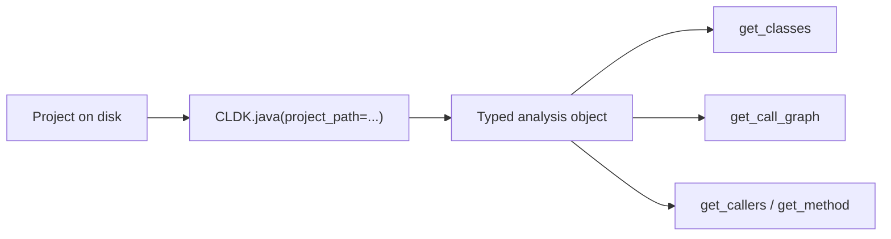

import { Tabs, TabItem, Steps, Aside, LinkCard, CardGrid } from "@astrojs/starlight/components";

CLDK loads a project and returns a typed `analysis` object. The object holds the classes and methods. If you ask for it, the object also holds the call graph. A code LLM or a tool can query this structure directly.

This guide has three steps: install CLDK, get a sample project, and run an analysis. The result is a typed model of [Apache Commons CLI](https://commons.apache.org/proper/commons-cli/) and a `networkx` call graph. The commands in this guide are for macOS and Linux.

<Steps>

1. **Install CLDK.**

   CLDK needs Python 3.11, 3.12, 3.13, or 3.14. To see your version, run `python3 --version`. If you have a different version, use a supported one to make the virtual environment, for example `python3.13 -m venv .venv`. With Python 3.10 or older, pip stops with `No matching distribution found`. With Python 3.15, pip falls back to an old CLDK release and then fails to build a dependency, for example `pyarrow` or `numpy`. For more, see [Supported Python versions](/installing/#supported-python-versions).

   Install CLDK with the `java` extra in a virtual environment:

   ```bash
   python3 -m venv .venv
   source .venv/bin/activate
   pip install "cldk[java]"
   ```

   The `java` extra installs the Java analyzer and its own JVM. To build the call graph, the analyzer compiles the project with Maven. For this step, you need `mvn` on your `PATH` and a JDK 11 or later. For the full prerequisites, see the Java Analysis tab in [Installing CLDK](/installing/#language-specific-dependencies).

   Without these tools, the analysis still finishes, but CLDK prints a warning. The call graph is then incomplete, with 648 nodes and 1950 edges instead of 652 and 1980. If you install the tools later, add `eager=True` to `CLDK.java(...)` once, because CLDK caches the incomplete result.

2. **Get a sample project.**

   This guide analyzes Apache Commons CLI 1.7.0. Clone the release tag. Note the location of the directory.

   ```shell
   git clone --depth 1 --branch rel/commons-cli-1.7.0 https://github.com/apache/commons-cli.git
   export JAVA_APP_PATH=$(pwd)/commons-cli
   ```

   Git can print `warning: ... is not a commit!` and a note about a detached HEAD. These messages are normal, and the clone is complete.

   <Aside type="note">
   Any Java project on disk works here. `JAVA_APP_PATH` must be the path to the project directory. Commons CLI is small and well structured, so the analysis runs quickly.
   </Aside>

3. **Run your first analysis.**

   Build an `analysis` object for Java. Point it at the project. Print the class count and the call graph. Call graphs, callers, and callees need `analysis_level=AnalysisLevel.call_graph`. The default level builds only the symbol table.

   Save this code as `first_analysis.py`. Then run `python first_analysis.py`:

   ```python title="first_analysis.py"
   import os
   from cldk import CLDK
   from cldk.analysis import AnalysisLevel

   analysis = CLDK.java(
       project_path=os.environ["JAVA_APP_PATH"],
       analysis_level=AnalysisLevel.call_graph,   # required for the call graph
   )

   print(len(analysis.get_classes()), "classes")
   print(analysis.get_call_graph())               # -> networkx.DiGraph (edges caller -> callee)
   # 75 classes
   # DiGraph with 652 nodes and 1980 edges
   ```

   The outputs come from cldk 2.0.0 and JDK 17 on Commons CLI 1.7.0. The class count includes the test classes, because Java analysis includes test sources. With JDK 21 or 25, the call graph has 1976 edges, not 1980. The first run is slower, because the analyzer compiles the project. Later runs use the cache in the project directory.

   `analysis` is now a typed model of the project that you can query. `get_call_graph()` returns a `networkx.DiGraph`. You can use standard graph operations for caller and callee queries.

</Steps>

## Analyze a Python project

The same pattern applies to a Python project. Use `CLDK.python(...)` with the path to the project directory. Every CLDK analysis needs a `project_path`. This example analyzes Flask 3.1.3.

In an activated virtual environment, set `SYSTEM_PYTHON` before you run the code. Without it, `CLDK.python(...)` can stop with `RuntimeError: Could not find a suitable base Python interpreter`. For details, see the Python Analysis tab in [Installing CLDK](/installing/#language-specific-dependencies).

```bash
git clone --depth 1 --branch 3.1.3 https://github.com/pallets/flask.git
export SYSTEM_PYTHON="$(python -c 'import sys; print(sys._base_executable)')"
```

Run this code from the directory that contains `flask`:

```python
from cldk import CLDK
from cldk.analysis import AnalysisLevel

analysis = CLDK.python(
    project_path="flask",
    analysis_level=AnalysisLevel.call_graph,
)
print(len(analysis.get_classes()), "classes")
print(analysis.get_call_graph().number_of_edges(), "call edges")
# 46 classes
# 1199 call edges
```

The first run installs Flask into a new virtual environment in `flask/.codeanalyzer/`, so it needs network access. The outputs come from cldk 2.0.0 on Flask 3.1.3. The example prints the edge count, because the node count can change by one between runs.

## How it works



One call converts a directory of source files into a typed `analysis` object. Then `get_method(qualified_class_name, qualified_method_name)` returns a `JCallable`. Its `code` field holds the body of the method. `get_callers` and `get_callees` walk the graph. The [concepts guide](/guides/concepts/) covers the object model. The [cheat sheet](/resources/cheatsheet/) lists the available methods.

## Next steps

The same calls run behind any tool that needs program facts. To understand what the backends build under these calls, read the guides in order.

<CardGrid>
  <LinkCard title="Core concepts" description="What a static analysis is, why it approximates, and the four levels CLDK builds." href="/guides/concepts/" />
  <LinkCard title="What is CLDK?" description="The programming model: language factory -> analysis object -> typed models." href="/what-is-cldk/" />
  <LinkCard title="Python examples" description="Worked snippets against Flask, from symbol table to call graph." href="/examples/python/" />
</CardGrid>
