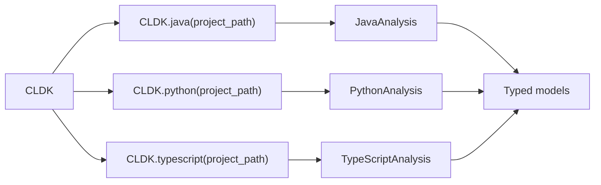

The `CLDK` class is the entry point of the SDK. It has one factory for each
language. A factory takes your project directory and returns an analysis object
for that language. You do not create a `JavaAnalysis`, `PythonAnalysis` or
`TypeScriptAnalysis` object yourself.



This page shows how to install cldk, build an analysis, and choose the analysis
level, the backend and the cache. The outputs come from cldk 2.0.0 on Commons
CLI 1.7.0 with JDK 17, Flask 3.1.3 and Zod 4.6.7. With JDK 21 or 25, the
Commons CLI call graph has 1976 edges, not 1980.

## Install

cldk 2.0.0 needs Python 3.11, 3.12, 3.13 or 3.14. It does not install on Python
3.15, because `ray`, a dependency of codeanalyzer-python, has no Python 3.15
wheel. On Python 3.14, pip compiles `tree-sitter` from source, so you need a C
compiler.

```bash
pip install cldk             # Python and TypeScript analysis
pip install "cldk[java]"     # adds Java analysis
pip install "cldk[neo4j]"    # adds the Neo4j driver
pip install "cldk[all]"      # adds both extras
```

Run the line that you need. Keep the quotes around an extra, because zsh reads
the brackets as a file pattern. With uv or Poetry, use `uv add` or `poetry add`
with the same argument. For the JDK and the build tool that Java call graphs
need, see [Installing CLDK](/installing/).

The Java samples on this page need the `java` extra. Without it, `CLDK.java(...)`
raises `CodeanalyzerExecutionException` with a message that starts with
`the Java analyzer is not installed`.

:::caution[Set SYSTEM_PYTHON in a virtual environment]
In an activated virtual environment, or under `uv run` or `poetry run`,
`CLDK.python(...)` and `canpy` can stop with
`RuntimeError: Could not find a suitable base Python interpreter`. To prevent
this error, set `SYSTEM_PYTHON` to the base interpreter of your virtual
environment before you run them.

On macOS and Linux, in the activated virtual environment:

```bash
export SYSTEM_PYTHON="$(python -c 'import sys; print(sys._base_executable)')"
```

On macOS and Linux, in a uv project:

```bash
export SYSTEM_PYTHON="$(uv run python -c 'import sys; print(sys._base_executable)')"
```

On macOS and Linux, in a Poetry project:

```bash
export SYSTEM_PYTHON="$(poetry run python -c 'import sys; print(sys._base_executable)')"
```

In Windows PowerShell, in the activated virtual environment:

```powershell
$env:SYSTEM_PYTHON = (python -c "import sys; print(sys._base_executable)")
```
:::

To run the samples on this page, clone the three sample projects into the
directory where you run Python:

```bash
git clone --depth 1 --branch rel/commons-cli-1.7.0 https://github.com/apache/commons-cli.git
git clone --depth 1 --branch 3.1.3 https://github.com/pallets/flask.git
git clone --depth 1 --branch v4.6.7 https://github.com/colinhacks/zod.git
```

## Build an analysis

Call the factory for the language of your project:

| Factory | Returns | Methods |
| ------- | ------- | ------- |
| [`CLDK.java(...)`](#cldkjava) | `JavaAnalysis` | [Java API](/reference/python-api/java/) |
| [`CLDK.python(...)`](#cldkpython) | `PythonAnalysis` | [Python API](/reference/python-api/python/) |
| [`CLDK.typescript(...)`](#cldktypescript) | `TypeScriptAnalysis` | [TypeScript API](/reference/python-api/typescript/) |

The three factories take the same parameters. Only `project_path` can be a
positional argument. Give all other arguments as keyword arguments. If you give
another argument by position, the call raises `TypeError`:

```python
from cldk import CLDK

analysis = CLDK.java("commons-cli", analysis_level="symbol_table")  # correct
analysis = CLDK.java("commons-cli", "symbol_table")
# TypeError: CLDK.java() takes from 0 to 1 positional arguments but 2 were given
```

| Parameter | Default | What it does |
| --------- | ------- | ------------ |
| `project_path` | `None` | The project directory, as a `str` or a `Path`. It must exist and be a directory. You can leave it out only with the Neo4j backend. |
| `analysis_level` | `AnalysisLevel.symbol_table` | How much the analyzer computes. See [Choose an analysis level](#choose-an-analysis-level). |
| `target_files` | `None` | A list of files to analyze, with paths relative to `project_path`. Each language handles it differently (see the list below). |
| `eager` | `False` | If `True`, CLDK runs the analyzer again and replaces the cache. See [The cache](#the-cache). |
| `backend` | `None` | A configuration object. Its type selects the backend. With `None`, CLDK uses the local backend. See [Choose a backend](#choose-a-backend). |

`target_files` has limits on each language:

- **Java:** on cldk 2.0.0, every call with `target_files` raises
  `CodeanalyzerExecutionException`. The analyzer rejects the option, and the
  exception shows only the command line. Do not use `target_files` with Java.
- **Python:** CLDK analyzes only the first file in the list, and logs a warning.
- **TypeScript:** the partial analysis replaces the cache. On the next full run,
  pass `eager=True`.

`CLDK` also has two tree-sitter helpers for Java source code. Call them on an
instance, for example `CLDK(language="java").treesitter_parser()`, not on the
class. See [Tree-sitter utilities](/reference/python-api/treesitter/).

## Choose an analysis level

`analysis_level` sets how much the analyzer computes. Each level adds to the
level before it. Give an `AnalysisLevel` member, or its name as a string, for
example `"call_graph"`. An unknown name raises `ValueError`.

| Level | Analyzer flag | Adds | Methods that need it |
| ----- | ------------- | ---- | -------------------- |
| `symbol_table` (default) | `-a 1` | modules, classes, callables, fields, imports | symbol-table methods, for example `get_classes` |
| `call_graph` | `-a 2` | the call graph | `get_call_graph`, `get_callers`, `get_callees`, `callers_of`, `callees_of`, `reaches`, `call_paths_between` |
| `program_dependency_graph` | `-a 3` | control flow, control dependence and data dependence inside each callable | `get_cfg`, `get_cdg`, `get_ddg` |
| `system_dependency_graph` | `-a 4` | dependence across calls | `resolve_value`, `slice_backward`, `slice_forward`, `flows_to_call`, `flows_to_argument`, `paths_between`, `taint` |

The generated entry for [`AnalysisLevel`](#analysislevel) lists the members and
their values.

:::caution[A level that is too low does not always raise an error]
Below `call_graph`, the call-graph methods do not raise an error. Python returns
a partial graph, and Java and TypeScript return empty results. For example, on a
new copy of Commons CLI at `symbol_table`, `get_call_graph()` returns a graph
with 0 nodes, and `get_callers(...)` returns `{}`. If the cache is at
`call_graph` or higher, Java and TypeScript return the cached call graph instead.

When the analysis level is too low, the methods in the last two rows of the
level table fail in different ways. Some raise `SelectorNotInGraph` even for a
correct name. The next table shows each case.
:::

| Method | Below `program_dependency_graph` | At `program_dependency_graph` |
| ------ | -------------------------------- | ----------------------------- |
| `get_cfg`, `get_cdg`, `get_ddg` | `CodeanalyzerUsageException` | Works |
| `resolve_value` | Java: works. Python and TypeScript: `SelectorNotInGraph`. | Java: works. Python and TypeScript: `SelectorNotInGraph`. |
| `slice_backward` | `CodeanalyzerUsageException` | Java: returns an empty slice. Python and TypeScript: `SelectorNotInGraph`. |
| `slice_forward`, `flows_to_call`, `flows_to_argument`, `paths_between` | `CodeanalyzerUsageException` | Java: `CodeanalyzerExecutionException`. Python and TypeScript: `SelectorNotInGraph`. |
| `taint` | Java: `CodeanalyzerUsageException`. Python and TypeScript: `SelectorNotInGraph`. | Java: `CodeanalyzerExecutionException`. Python and TypeScript: `SelectorNotInGraph`. |

At `system_dependency_graph`, all these methods work on the three languages. For
the methods in the last row of the level table, ask for
`system_dependency_graph`.

With the Neo4j backend, `analysis_level` has no effect, because the graph holds
every level.

## Choose a backend

The type of the `backend=` object selects the backend:

- The **local backend** is the default. It runs the analyzer on your machine and
  caches the result. Java runs `codeanalyzer-java` in a subprocess, on the JVM
  that the `java` extra installs. Python runs `codeanalyzer-python` in your
  Python process. TypeScript runs the `codeanalyzer-typescript` binary in a
  subprocess.
- The **Neo4j backend** reads a graph that an analyzer wrote into a Neo4j
  database before. It does not change the graph.

| Class | Fields and defaults | Factories |
| ----- | ------------------- | --------- |
| [`CodeAnalyzerConfig`](#codeanalyzerconfig) | `cache_dir=None` | `CLDK.java`, `CLDK.typescript` |
| [`PyCodeAnalyzerConfig`](#pycodeanalyzerconfig) | `cache_dir=None`, `use_ray=False` | `CLDK.python` |
| [`TSCodeAnalyzerConfig`](#tscodeanalyzerconfig) | `cache_dir=None`, `tsc_only=False` (deprecated, no effect) | `CLDK.typescript` |
| [`Neo4jConnectionConfig`](#neo4jconnectionconfig) | `uri` (required), `username="neo4j"`, `password="neo4j"`, `database=None`, `application_name=None` | all three |

The first three classes select the local backend. With `cache_dir=None`, the
cache is in `<project>/.codeanalyzer`. `use_ray=True` runs the Python analysis
in parallel with Ray. With `database=None`, CLDK uses the default database of
the server. The generated entries describe each field.

### Use the Neo4j backend

The Neo4j backend needs four things:

1. The driver: `pip install "cldk[neo4j]"`.
2. A running Neo4j server.
3. A graph from the analyzer that cldk 2.0.0 pins. `pip install cldk` installs
   `canpy` for Python and `cants` for TypeScript. The `java` extra installs
   `canjv`. A graph from codeanalyzer-java older than 3.2.0, codeanalyzer-python
   older than 1.5.0 or codeanalyzer-typescript older than 1.5.2 raises
   `GraphSchemaMismatch`.
4. The application name of the graph, in `application_name`. The analyzer sets
   this name with `--app-name`. The default is the name of the project
   directory.

For example, write the Commons CLI graph with `canjv`:

```bash
export NEO4J_PASSWORD="<your password>"
canjv -i commons-cli --emit neo4j --neo4j-uri bolt://localhost:7687
```

With `--emit neo4j`, `canjv` builds the project, so it needs the JDK and Maven
too. For a Python or TypeScript project, run `canpy` or `cants` with the same
options. Then read the graph:

```python
import os

from cldk import CLDK
from cldk.analysis.commons.backend_config import Neo4jConnectionConfig

analysis = CLDK.java(
    backend=Neo4jConnectionConfig(
        uri="bolt://localhost:7687",
        password=os.environ["NEO4J_PASSWORD"],
        application_name="commons-cli",
    ),
)

print(len(analysis.get_classes()))    # 75
print(analysis.get_call_graph())      # DiGraph with 652 nodes and 1980 edges
```

These rules apply to the Neo4j backend:

- `project_path` is optional. If you give it, the directory must exist, and
  `application_name` defaults to the directory name. If you leave out
  `project_path` and `application_name`, the factory raises
  `CodeanalyzerExecutionException`.
- `analysis_level` has no effect. The graph holds every level, so the example
  gets the call graph at the default level.
- If `application_name` matches no application in the graph, the factory raises
  `GraphSchemaMismatch`. The message says that the graph is too old. Check the
  name first.
- On cldk 2.0.0, the TypeScript backend cannot read every graph. If a file has
  two declarations with the same name, for example an interface and a function,
  the read can fail. `CLDK.typescript(backend=...)` then raises
  `ValueError: child id is not minted under its parent`. The Zod graph has this
  problem. For such a project, use the local backend.
- The driver can log warnings that start with
  `Received notification from DBMS server`. They do not stop the analysis.

## The cache

The local backend caches its result in `<project>/.codeanalyzer/<language>/`,
for all three languages. Add `.codeanalyzer/` to your `.gitignore` file. To put
the cache in a different directory, give `cache_dir`:

```python
from cldk import CLDK
from cldk.analysis.commons.backend_config import CodeAnalyzerConfig

analysis = CLDK.java(
    project_path="commons-cli",
    backend=CodeAnalyzerConfig(cache_dir="cldk-cache"),
)
# The cache is in cldk-cache/java/, not in commons-cli/.codeanalyzer/
```

For Python, the cache also holds a virtual environment with the project and its
dependencies. The first run builds it, so it needs network access and takes
longer.

CLDK reuses the cache with these rules:

- Java and TypeScript reuse the cached `analysis.json` without a check of your
  source files. After you change the code, pass `eager=True` once. If you do
  not, you get the old result.
- If the cache has a lower analysis level than the request, Java runs the
  analyzer again. TypeScript does not. When you raise `analysis_level` on a
  TypeScript project that you analyzed before, pass `eager=True` once. If you do
  not, you get the old level, with no warning.
- A TypeScript run with `target_files` writes over the cache. On the next full
  run, pass `eager=True`.
- Python finds source changes without `eager=True`.
- Java also caches an incomplete call graph (see the [Java](#java) example).
  After you install the JDK and Maven, pass `eager=True` once.

## Errors you can see

The CLDK exceptions are in `cldk.utils.exceptions`:

```python
from cldk.utils.exceptions import (
    AmbiguousName,
    CldkInitializationException,
    CodeanalyzerExecutionException,
    CodeanalyzerUsageException,
    GraphSchemaMismatch,
    SelectorNotInGraph,
)
```

| Exception | When | What to do |
| --------- | ---- | ---------- |
| `CldkInitializationException` | `project_path` does not exist or is not a directory. `CLDK.java()` has no `project_path`. | Give the path of an existing project directory. |
| `CodeanalyzerExecutionException` | An extra is missing (`java`, or the `neo4j` driver). The analyzer failed, for example with `target_files` on Java. A Java cache comes from cldk 1.x. A Neo4j backend has no `application_name` and no `project_path`. On Java, a method from the last row of the [level table](#choose-an-analysis-level) runs at `program_dependency_graph`. | Read the message. Install the missing extra. On Java, remove `target_files`. For a 1.x cache, pass `eager=True` once. For Neo4j, set `application_name`. For a method from the last row of the level table, use `system_dependency_graph`. |
| `CodeanalyzerUsageException` | `get_cfg`, `get_cdg`, `get_ddg`, `slice_backward`, `slice_forward`, `flows_to_call`, `flows_to_argument` or `paths_between` runs on an analysis below `program_dependency_graph`. On Java, `taint` also raises it below that level. See [Choose an analysis level](#choose-an-analysis-level). | Build the analysis again at the level that the method needs. On TypeScript, also pass `eager=True` once. |
| `SelectorNotInGraph` | A name or a path is not in the analysis. It is a `ValueError`. On Python and TypeScript, a method from the last row of the [level table](#choose-an-analysis-level) also raises it for a correct name below `system_dependency_graph`. | If the name is correct, build the analysis at `system_dependency_graph`. On TypeScript, also pass `eager=True` once. If the name is not correct, copy it from `get_classes()`, or use `resolve_callable(name)`. |
| `AmbiguousName` | A name matches more than one callable or value. It is a `ValueError`, and its `candidates` attribute lists the matches. | Use one name from `candidates`. You can also narrow the name as the message says, for example with `in_class=` or a longer `within=`. |
| `GraphSchemaMismatch` | The database has no graph, the graph comes from an analyzer that is too old, or `application_name` does not match the graph. | Check `application_name`. Then emit the graph again with the pinned analyzer, into an empty database. |
| `ValueError` | The `analysis_level` name is unknown. `CLDK.python()` has no `project_path`. The TypeScript Neo4j backend cannot read the graph (`child id is not minted under its parent`). | Use an `AnalysisLevel` name. Give `project_path`. For that TypeScript project, use the local backend. |
| `TypeError` | An argument after `project_path` is positional. `CLDK.typescript()` has no `project_path`. | Give the other arguments as keywords. Give `project_path`. |
| `KeyError` | A Java file accessor, for example `get_java_compilation_unit`, gets a path that is not in the analysis, for example an absolute path. | Give the path relative to `project_path`, as `get_java_file(...)` returns it. |
| `neo4j.exceptions.ServiceUnavailable`, `neo4j.exceptions.AuthError` | CLDK cannot connect to the Neo4j server, or the user name or the password is wrong. | Start the server. Check `uri`, `username` and `password`. |
| `pydantic.ValidationError` | A TypeScript cache comes from cldk 1.x. The message says `validation errors for TSAnalysis`. | Delete `<project>/.codeanalyzer`, or pass `eager=True` once. |
| `RuntimeError` | codeanalyzer-python (in `CLDK.python` or `canpy`) cannot find a base interpreter (`Could not find a suitable base Python interpreter`). | Set `SYSTEM_PYTHON`. See [Install](#install). |

[Results and errors](/reference/python-api/results/#exceptions) documents the
attributes of each exception.

## Worked example

These examples use the sample projects from [Install](#install).

### Java

```python
from cldk import CLDK
from cldk.analysis import AnalysisLevel

analysis = CLDK.java(
    project_path="commons-cli",
    analysis_level=AnalysisLevel.call_graph,   # needed for call-graph methods
)

print(type(analysis).__name__)        # JavaAnalysis
print(len(analysis.get_classes()))    # 75
print(analysis.get_call_graph())      # DiGraph with 652 nodes and 1980 edges
```

The 75 classes include 44 test classes from `src/test`, and nested classes, for
example `org.apache.commons.cli.Option.Builder`. Java analysis includes test
sources, and you cannot turn this off. Python and TypeScript analysis skip
tests. To keep only the main sources, filter on the file path. This block
continues the block above:

```python
main = [name for name in analysis.get_classes()
        if not analysis.get_java_file(name).startswith("src/test/")]
print(len(main))                      # 31
```

For `call_graph` and deeper, Java needs a JDK 11 or later, and Maven or Gradle.
Without them, the analysis still finishes, but the call graph is incomplete: 648
nodes and 1950 edges instead of 652 and 1980. CLDK logs a warning that starts
with `codeanalyzer-java did not fully compute`. To fix this, install the JDK and
the build tool (see [Installing CLDK](/installing/)). Then run the analysis
again with `eager=True`, because the cache keeps the incomplete graph.

### Python

If you run this block in an activated virtual environment, or under `uv run` or
`poetry run`, set `SYSTEM_PYTHON` first (see [Install](#install)).

```python
from cldk import CLDK

analysis = CLDK.python(project_path="flask")

print(type(analysis).__name__)        # PythonAnalysis
classes = analysis.get_classes()      # dict: class name -> PyClass
print(len(classes))                   # 46
print(sorted(classes)[0])             # src.flask.app.Flask
```

Python names are dotted paths from `project_path`. The file `src/flask/app.py`
gives `src.flask.app.Flask`, not the import name `flask.app.Flask`. The first
run makes a virtual environment and installs Flask into it, so it needs network
access.

### TypeScript

```python
from cldk import CLDK

analysis = CLDK.typescript(project_path="zod/packages/zod")

print(type(analysis).__name__)        # TypeScriptAnalysis
print(len(analysis.get_classes()))    # 53
```

`CLDK.typescript(...)` also analyzes JavaScript files. The analyzer runs
`npm install` in the project, so it needs network access. If `npm install`
fails, as it does on Zod, the analysis continues with fewer resolved types.

The three analysis objects share most method names, for example `get_classes()`
and `get_call_graph()`.

For more, see the [Java](/examples/java/), [Python](/examples/python/) and
[TypeScript](/examples/typescript/) examples. [Core concepts](/guides/concepts/)
explains analysis levels and call graphs, and the
[cheat sheet](/resources/cheatsheet/) is a one-page summary.

## Upgrade from 1.5.0

To upgrade, run `pip install -U "cldk[java]"`. If you do not analyze Java, run
`pip install -U cldk`. Then check these changes:

- **Delete the 1.x cache.** cldk 2.0.0 cannot read a Java or TypeScript cache
  from cldk 1.x. Java raises `CodeanalyzerExecutionException` with
  `predates schema v2`, and TypeScript raises a pydantic `ValidationError`.
  Delete `<project>/.codeanalyzer`, or pass `eager=True` once. The Java message
  says `eager_analysis=True`, but the factories do not accept that keyword. A
  Python cache from cldk 1.x does not cause an error.
- **Install the `java` extra for Java.** Java analysis needs `cldk[java]`.
- **Stop C analysis.** cldk 2.0.0 has no `CLDK.c()`. If you need C, pin
  `cldk<2`.
- **Analyze the project directory.** cldk 2.0.0 has no Java `source_code` mode.
- **Read Java call-graph nodes as strings**, in the form
  `"<type fqn>.<signature>"`, where fqn is the fully qualified name. An example
  is `"org.apache.commons.cli.Options.addOption(org.apache.commons.cli.Option)"`.
  To get the class of a node `key` in `cg = analysis.get_call_graph()`, read
  `cg.nodes[key]["method_detail"].klass`.
- **`PyCallableOverview.path` is relative** to the project directory.
- **Replace the removed methods.** `PythonAnalysis` lost 15 methods that only
  raised `NotImplementedError`. `TypeScriptAnalysis` lost
  `get_entry_point_methods` and `get_service_entry_point_methods`. Use
  `get_entrypoints()` and `get_entrypoint_classes()`.
- **Emit each Neo4j graph again**, with the pinned analyzer, into an empty
  database.

The [CHANGELOG](https://github.com/codellm-devkit/python-sdk/blob/v2.0.0/CHANGELOG.md)
gives the full list.

:::caution[Deprecated]
The 1.x form `CLDK(language="java").analysis(project_path=...)` still works in
cldk 2.0.0. It emits a `DeprecationWarning` and calls the factory for the
language. In new code, use `CLDK.java(...)`, `CLDK.python(...)` or
`CLDK.typescript(...)`.
:::

<!-- Remove each item when the SDK docstring is fixed. -->
:::caution[Errors in the generated reference]
The reference below comes from the docstrings of cldk 2.0.0. Some statements in
it are wrong. These are the important ones:

- `project_path`: "Optional only when `backend` is a `Neo4jConnectionConfig`".
  Without `project_path`, also set `application_name`. If you do not, the
  factory raises `CodeanalyzerExecutionException`.
- `target_files`: "Restrict analysis to these files". On Java, every call with
  `target_files` raises `CodeanalyzerExecutionException`. On Python, CLDK
  analyzes only the first file.
- `Neo4jConnectionConfig`: "a job that runs `codeanalyzer-* --emit neo4j`". No
  `codeanalyzer-*` command exists. Run `canjv`, `canpy` or `cants`.
- `CLDK.analysis`: "forwards to `java` / `python` / `typescript` with an
  appropriate `backend=` configuration object". For Java, it ignores
  `neo4j_config=` and runs a local analysis. Use
  `CLDK.java(backend=Neo4jConnectionConfig(...))`.
- `CodeAnalyzerConfig` and `TSCodeAnalyzerConfig`: "Select the in-process
  codeanalyzer backend". Only Python runs in your process. Java and TypeScript
  run the analyzer in a subprocess.
:::

## API reference

The full generated reference follows.

<!-- CLDK:API:START -->

<!-- AUTO-GENERATED by scripts/gen_api_docs.py, do not edit by hand. -->

[](https://github.com/codellm-devkit/python-sdk) [](https://pypi.org/project/cldk/2.0.0/)

_API reference generated from cldk 2.0.0._

Core CLDK module.

This module provides the top-level entry point for the Code Language Development
Kit (CLDK), a unified framework for performing static analysis across multiple
programming languages. The primary interface is the `CLDK` class, which
serves as a factory for creating language-specific analysis objects, tree-sitter
parsers, and sanitization utilities.

The CLDK supports the following languages:
- **Java**: Full static analysis via CodeAnalyzer backend, including symbol
  tables, call graphs, and code metrics.
- **Python**: Static analysis via codeanalyzer-python backend (Jedi plus
  PyCG call-graph construction).

Typical usage involves instantiating `CLDK` with a target language, then
calling `CLDK.analysis` to obtain a language-specific analysis facade.

:::note
This module requires language-specific backends to be available:
- Java: `codeanalyzer-java` (the `cldk[java]` extra; carries the jar and its JVM)
- Python: `codeanalyzer-python` (auto-installed in virtualenv)
:::

### `CLDK`

```python
class CLDK
```

| Method | Summary |
| ------ | ------- |
| [`java`](#cldkjava) | Create a Java analysis facade. |
| [`python`](#cldkpython) | Create a Python analysis facade. |
| [`typescript`](#cldktypescript) | Create a TypeScript analysis facade. |
| [`analysis`](#cldkanalysis) | Deprecated entry point. |
| [`treesitter_parser`](#cldktreesitter_parser) | Return a Tree-sitter parser for the selected language. |
| [`tree_sitter_utils`](#cldktree_sitter_utils) | Return Tree-sitter-based code sanitization utilities for the selected language. |

Core class for the Code Language Development Kit (CLDK).

The CLDK class serves as the primary entry point and factory for all code
analysis operations. It provides a unified interface for initializing
language-specific analysis facades, tree-sitter parsers, and code
sanitization utilities.

This class follows the factory pattern, where the `language` parameter
determines which concrete analysis implementation is returned by the
`analysis`, `treesitter_parser`, and `tree_sitter_utils`
methods.

**Parameters:**

| Name | Type | Description |
| ---- | ---- | ----------- |
| `language` | `str` | The target programming language for analysis. Supported values are `"java"`, `"python"`, and `"typescript"` (case-sensitive). |

**Raises:**

- `NotImplementedError`: Raised by factory methods when the specified
  language is not yet supported.

> **See Also**
>
> - `JavaAnalysis`: Java-specific analysis facade.
> - `PythonAnalysis`: Python-specific analysis facade.

#### Attributes

| Name | Type | Description |
| ---- | ---- | ----------- |
| `language` | `str` | The programming language specified during initialization. This determines which analysis backend and utilities are used. |

#### Methods

##### `CLDK.java`

```python
@staticmethod
java(
    project_path: str | Path | None = None,
    *,
    analysis_level: str = AnalysisLevel.symbol_table,
    target_files: List[str] | None = None,
    eager: bool = False,
    backend: JavaBackend | None = None,
) -> JavaAnalysis
```

Create a Java analysis facade.

**Parameters:**

| Name | Type | Description |
| ---- | ---- | ----------- |
| `project_path` | `str \| Path \| None` | Path to the Java project directory. Optional only when `backend` is a `Neo4jConnectionConfig` (the graph is read out of band over Bolt). When provided, the path is validated (it must exist and be a directory) regardless of backend. |
| `analysis_level` | `str` | Analysis depth (see `AnalysisLevel`). |
| `target_files` | `List[str] \| None` | Restrict analysis to these files. |
| `eager` | `bool` | Force regeneration of cached analysis. |
| `backend` | [`JavaBackend \| None`](#javabackend) | Backend configuration. Defaults to `CodeAnalyzerConfig`; pass a `Neo4jConnectionConfig` to use the read-only Neo4j backend. |

**Raises:**

- [`CldkInitializationException`](/reference/python-api/results/#cldkinitializationexception): If `project_path` is missing and the backend is not
  Neo4j. (The 1.x `source_code` single-file mode was removed in 2.0.)

##### `CLDK.python`

```python
@staticmethod
python(
    project_path: str | Path | None = None,
    *,
    analysis_level: str = AnalysisLevel.symbol_table,
    target_files: List[str] | None = None,
    eager: bool = False,
    backend: PyBackend | None = None,
) -> PythonAnalysis
```

Create a Python analysis facade.

**Parameters:**

| Name | Type | Description |
| ---- | ---- | ----------- |
| `project_path` | `str \| Path \| None` | Path to the Python project directory. Optional only when `backend` is a `Neo4jConnectionConfig` (the graph is populated out of band over Bolt). When provided, the path is validated (it must exist and be a directory) regardless of backend. |
| `analysis_level` | `str` | Analysis depth (see `AnalysisLevel`). |
| `target_files` | `List[str] \| None` | Restrict analysis to these files. |
| `eager` | `bool` | Force regeneration of cached analysis. |
| `backend` | [`PyBackend \| None`](#pybackend) | Backend configuration. Defaults to `PyCodeAnalyzerConfig`; pass a `Neo4jConnectionConfig` to use the read-only Neo4j backend. |

##### `CLDK.typescript`

```python
@staticmethod
typescript(
    project_path: str | Path | None = None,
    *,
    analysis_level: str = AnalysisLevel.symbol_table,
    target_files: List[str] | None = None,
    eager: bool = False,
    backend: TSBackend | None = None,
) -> TypeScriptAnalysis
```

Create a TypeScript analysis facade.

**Parameters:**

| Name | Type | Description |
| ---- | ---- | ----------- |
| `project_path` | `str \| Path \| None` | Path to the TypeScript project directory. Optional only when `backend` is a `Neo4jConnectionConfig` (the graph is populated out of band over Bolt). When provided, the path is validated (it must exist and be a directory) regardless of backend. |
| `analysis_level` | `str` | Analysis depth (see `AnalysisLevel`). |
| `target_files` | `List[str] \| None` | Restrict analysis to these files. |
| `eager` | `bool` | Force regeneration of cached analysis. |
| `backend` | [`TSBackend \| None`](#tsbackend) | Backend configuration. Defaults to `CodeAnalyzerConfig`; pass a `TSCodeAnalyzerConfig` (its `tsc_only` is a deprecated no-op, codeanalyzer-typescript removed `--tsc-only` in 1.0.0), or a `Neo4jConnectionConfig` to use the read-only Neo4j backend. |

##### `CLDK.analysis`

```python
analysis(
    project_path: str | Path | None = None,
    source_code: str | None = None,
    eager: bool = False,
    analysis_level: str = AnalysisLevel.symbol_table,
    target_files: List[str] | None = None,
    analysis_backend_path: str | None = None,
    analysis_json_path: str | Path | None = None,
    cache_dir: str | Path | None = None,
    use_ray: bool = False,
    neo4j_config: Neo4jConnectionConfig | None = None,
) -> JavaAnalysis | PythonAnalysis | TypeScriptAnalysis
```

Deprecated entry point. Use the per-language factory methods instead.

`CLDK(language).analysis(...)` is retained as a thin compatibility shim that forwards to
`java` / `python` / `typescript` with an appropriate
`backend=` configuration object.

The former `analysis_json_path` is folded into the unified `cache_dir` (it is used as
the cache root when `cache_dir` is not given). `analysis_backend_path` is no longer
supported: the backend binary ships with the packaged dependency, and passing it is ignored.

:::caution[Deprecated]
Use `CLDK.java`, `CLDK.python`, or `CLDK.typescript`
with a `backend=<config>` object.
:::

##### `CLDK.treesitter_parser`

```python
treesitter_parser() -> TreesitterJava
```

Return a Tree-sitter parser for the selected language.

Creates and returns a language-specific Tree-sitter parser instance
that can be used for syntactic analysis, AST traversal, and code
querying operations. Tree-sitter provides incremental parsing with
excellent performance characteristics for real-time code analysis.

The returned parser provides methods for:
- Parsing source code into an AST
- Running Tree-sitter queries to extract code patterns
- Extracting syntactic elements (methods, classes, imports, etc.)
- Performing lexical analysis

**Returns:**

- [`TreesitterJava`](/reference/python-api/treesitter/#treesitterjava): A Tree-sitter parser wrapper for Java source code.
  The parser provides methods such as `is_parsable`,
  `get_raw_ast`, `get_all_imports`, and various
  code extraction utilities.

**Raises:**

- `NotImplementedError`: If the language specified during CLDK
  initialization does not have a Tree-sitter parser implementation.
  Currently, only Java is supported.

:::note
The Tree-sitter parser operates at the syntactic level only and
does not perform semantic analysis. For semantic information like
resolved types or call graphs, use `analysis` instead.
:::

> **See Also**
>
> - `TreesitterJava`: Java Tree-sitter parser implementation.

##### `CLDK.tree_sitter_utils`

```python
tree_sitter_utils(source_code: str) -> TreesitterSanitizer
```

Return Tree-sitter-based code sanitization utilities for the selected language.

Creates and returns a utility class that provides code transformation
and sanitization operations using Tree-sitter for parsing. These utilities
are particularly useful for preparing code for LLM consumption, test
generation, and code analysis tasks.

The sanitization utilities provide operations such as:
- Removing unused imports from source code
- Keeping only focal methods and their callees for context reduction
- Extracting and manipulating test assertions
- Identifying and removing dead code

**Parameters:**

| Name | Type | Description |
| ---- | ---- | ----------- |
| `source_code` | `str` | The source code string to initialize the utilities with. This code will be parsed and made available for transformation operations. Must be valid syntax for the target language. |

**Returns:**

- [`TreesitterSanitizer`](/reference/python-api/treesitter/#treesittersanitizer): A utility wrapper that provides sanitization
  and transformation methods for Java source code, including:
  - `keep_only_focal_method_and_its_callees`
  - `remove_unused_imports`

**Raises:**

- `NotImplementedError`: If the language specified during CLDK
  initialization does not have sanitization utilities implemented.
  Currently, only Java is supported.

:::note
The sanitization utilities modify code at the syntactic level using
Tree-sitter patterns. For complex refactoring that requires semantic
understanding, consider using the full analysis capabilities via
`analysis`.
:::

> **See Also**
>
> - `TreesitterSanitizer`: Java sanitization utility implementation.
> - `treesitter_parser`: For raw Tree-sitter parsing without sanitization utilities.

## Analysis levels

```python
from cldk.analysis import AnalysisLevel
```

### `AnalysisLevel`

```python
class AnalysisLevel(str, Enum)
```

Analysis levels

#### Attributes

| Name | Value | Description |
| ---- | ----- | ----------- |
| `symbol_table` | `'symbol table'` |  |
| `call_graph` | `'call graph'` |  |
| `program_dependency_graph` | `'program dependency graph'` |  |
| `system_dependency_graph` | `'system dependency graph'` |  |

## Backend configuration

```python
from cldk.analysis.commons.backend_config import (
    CodeAnalyzerConfig,
    PyCodeAnalyzerConfig,
    TSCodeAnalyzerConfig,
    Neo4jConnectionConfig,
    JavaBackend,
    PyBackend,
    TSBackend,
    cache_subdir,
)
```

### `CodeAnalyzerConfig`

```python
class CodeAnalyzerConfig
```

Select the in-process codeanalyzer backend.

The backend binary is sourced from the packaged `codeanalyzer-*` dependency, so the only
knob is where analysis artifacts are cached.

#### Attributes

| Name | Type | Default | Description |
| ---- | ---- | ------- | ----------- |
| `cache_dir` | `Union[str, Path, None]` | `None` | Root directory for analysis artifacts. When `None` the facade defaults it to `<project>/.codeanalyzer`. Each backend writes under a language-keyed subdirectory of this root (see `cache_subdir`), so the same root can be shared across languages. |

### `PyCodeAnalyzerConfig`

```python
class PyCodeAnalyzerConfig(CodeAnalyzerConfig)
```

Select the in-process codeanalyzer backend for Python.

Adds the Python-only call-graph knobs on top of `CodeAnalyzerConfig`.

#### Attributes

| Name | Type | Default | Description |
| ---- | ---- | ------- | ----------- |
| `use_ray` | `bool` | `False` | If `True`, enable Ray-based parallel processing for large projects. |

### `TSCodeAnalyzerConfig`

```python
class TSCodeAnalyzerConfig(CodeAnalyzerConfig)
```

Select the in-process codeanalyzer backend for TypeScript.

Kept distinct from `CodeAnalyzerConfig` for the one knob it used to add; that knob is
now a no-op, and the class stays so existing call sites keep constructing it.

#### Attributes

| Name | Type | Default | Description |
| ---- | ---- | ------- | ----------- |
| `tsc_only` | `bool` | `False` | **Deprecated, no-op.** codeanalyzer-typescript removed `--tsc-only` in 1.0.0: the call graph always carries both resolvers, each edge tagged with its provenance (`tsc` / `defuse` / `import`). Passing `True` emits a `DeprecationWarning` and changes nothing; filter edges by `provenance` instead. |

### `Neo4jConnectionConfig`

```python
class Neo4jConnectionConfig
```

Select the read-only Neo4j-backed analysis backend.

The graph is always populated out of band (e.g. a job that runs `codeanalyzer-* --emit
neo4j`); the SDK only polls it. This config carries the connection details and which
application to scope queries to.

#### Attributes

| Name | Type | Default | Description |
| ---- | ---- | ------- | ----------- |
| `uri` | `str` |  | Bolt URI of the Neo4j server (e.g. `bolt://localhost:7687`). |
| `username` | `str` | `'neo4j'` | Neo4j username (read-only credentials are sufficient). |
| `password` | `str` | `'neo4j'` | Neo4j password. |
| `database` | `str \| None` | `None` | Database name (`None` => server default). |
| `application_name` | `str \| None` | `None` | The application anchor name to scope queries to. Matches the `--app-name` the graph was loaded with (defaults to the project directory name). |

### `JavaBackend`

```python
JavaBackend = Union[CodeAnalyzerConfig, Neo4jConnectionConfig]
```

One of [`CodeAnalyzerConfig`](#codeanalyzerconfig) or [`Neo4jConnectionConfig`](#neo4jconnectionconfig).

### `PyBackend`

```python
PyBackend = Union[PyCodeAnalyzerConfig, Neo4jConnectionConfig]
```

One of [`PyCodeAnalyzerConfig`](#pycodeanalyzerconfig) or [`Neo4jConnectionConfig`](#neo4jconnectionconfig).

### `TSBackend`

```python
TSBackend = Union[TSCodeAnalyzerConfig, CodeAnalyzerConfig, Neo4jConnectionConfig]
```

One of [`TSCodeAnalyzerConfig`](#tscodeanalyzerconfig), [`CodeAnalyzerConfig`](#codeanalyzerconfig) or [`Neo4jConnectionConfig`](#neo4jconnectionconfig).

### `cache_subdir`

```python
cache_subdir(
    cache_dir: Union[str, Path, None],
    project_dir: Union[str, Path, None],
    language: str,
) -> Path | None
```

Resolve the language-keyed cache directory for a backend.

**Parameters:**

| Name | Type | Description |
| ---- | ---- | ----------- |
| `cache_dir` | `Union[str, Path, None]` | The cache root from the backend config. When `None`, defaults to `<project_dir>/.codeanalyzer`. |
| `project_dir` | `Union[str, Path, None]` | The project directory, used to derive the default root. |
| `language` | `str` | The canonical language key (`"java"`, `"python"`, `"typescript"`). |

**Returns:**

- `Path | None`: `<root>/<language>` as an absolute path, or `None` if no root can be determined
  (no `cache_dir` and no `project_dir`).

<!-- CLDK:API:END -->
