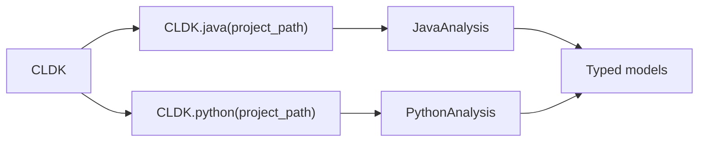

The `CLDK` class is the top-level entry point. Call the per-language factory, for
example `CLDK.java(project_path=...)`, to get an analysis object over your
project. You never build a `JavaAnalysis` or a `PythonAnalysis` yourself. The
factory hands you the correct one.

## Overview

One call per language, always the same shape:

```python
from cldk import CLDK

analysis = CLDK.java(project_path="commons-cli")
# -> JavaAnalysis, ready to query
```

The per-language factory methods are the top-level API:

- **`CLDK.java(...)`** -> [`JavaAnalysis`](/reference/python-api/java/)
- **`CLDK.python(...)`** -> [`PythonAnalysis`](/reference/python-api/python/)
- **`CLDK.typescript(...)`** -> [`TypeScriptAnalysis`](/reference/python-api/typescript/)

A language-specific backend sits behind each factory and builds the symbol table
and the call graph. CLDK 1.x also has `CLDK.c(project_path)`, and CLDK 2.0
removes it.



<aside>
The legacy `CLDK(language="java").analysis(project_path=...)` form still works but
is **deprecated** (it emits a `DeprecationWarning` and forwards to the factories).
Prefer `CLDK.java(project_path=...)` in new code.
</aside>

**Analysis levels.** `analysis_level` controls the depth of the analysis. The
default, `AnalysisLevel.symbol_table`, populates classes, methods, and fields.
`AnalysisLevel.call_graph` costs more and is required for `get_call_graph`,
`get_callers`, and `get_callees`. CLDK 2.0 adds
`AnalysisLevel.program_dependency_graph` and
`AnalysisLevel.system_dependency_graph` for dataflow. See
[Dataflow graphs](/guides/dataflow/). If you need call relationships, set the
level when you build the analysis.

### Common factory arguments

| Argument | Applies to | What it does |
| -------- | ---------- | ------------ |
| `project_path` | all | Path to the project directory to analyze. |
| `analysis_level` | all | `symbol_table` (default), `call_graph`, `program_dependency_graph`, or `system_dependency_graph`. The call graph, callers, and callees need `call_graph`. Dataflow and taint need level 3 or 4. |
| `target_files` | all | Restrict analysis to specific files. |
| `eager` | all | Force a fresh analysis even when a cached artifact exists. |
| `backend` | all | A configuration object that selects the backend. Omit it for the default in-process backend. Pass `Neo4jConnectionConfig(...)` for a read-only Neo4j backend. |

### Backend selection

The **type** of the `backend=` configuration object selects the backend:

- Omit `backend=` to use the default in-process backend. To tune it, pass
  `CodeAnalyzerConfig(...)` for Java and TypeScript, or
  `PyCodeAnalyzerConfig(...)` for Python, which adds `use_ray`.
- Pass `Neo4jConnectionConfig(uri=..., username=..., password=..., database=...,
  application_name=...)` for a read-only Neo4j backend.

```python
from cldk.analysis.commons.backend_config import (
    CodeAnalyzerConfig,
    PyCodeAnalyzerConfig,
    Neo4jConnectionConfig,
)
```

Analysis artifacts are cached under `cache_dir` (default `<project>/.codeanalyzer`,
with per-language artifacts under `<cache_dir>/<language>/`). Caching is on by
default for Java and TypeScript.

See the [generated reference](#api-reference) below for the full signature.

## Worked example

The recurring sample project is
[Apache Commons CLI](https://commons.apache.org/proper/commons-cli/), unpacked at
`commons-cli`.

### Construct a Java analysis

```python
from cldk import CLDK
from cldk.analysis import AnalysisLevel

analysis = CLDK.java(
    project_path="commons-cli",
    analysis_level=AnalysisLevel.call_graph,   # needed for call-graph methods
)

print(type(analysis).__name__)        # JavaAnalysis
print(len(analysis.get_classes()))    # 23
```

In CLDK 2.0 the Java backend is the optional extra `cldk[java]`. Its wheel
carries the analyzer jar and its own JVM. Results are cached under
`<project>/.codeanalyzer` and reused on later runs. Every method lives on
`analysis`. For the full surface, see the
[Java API reference](/reference/python-api/java/).

### Construct a Python analysis

```python
from cldk import CLDK

analysis = CLDK.python(project_path="my_pkg")

print(type(analysis).__name__)        # PythonAnalysis
classes = analysis.get_classes()      # Dict[str, PyClass]
```

The shape and the method names are the same. Only the factory changes. The
[Python API reference](/reference/python-api/python/) documents the methods.

For an introduction, see [What is CLDK?](/what-is-cldk/) and the
[Quickstart](/quickstart/). For task-oriented snippets, see
[Common tasks](/guides/common-tasks/) and the
[COCOA](/cocoa/). The [concepts](/guides/concepts/) page
explains analysis levels and call graphs in detail, and the
[cheat sheet](/resources/cheatsheet/) is a one-page summary.

## API reference

The full generated reference follows.

<!-- CLDK:API:START -->

<!-- AUTO-GENERATED by scripts/gen_api_docs.py, do not edit by hand. -->

[](https://github.com/codellm-devkit/python-sdk) [](https://pypi.org/project/cldk/2.0.0/)

_API reference generated from cldk 2.0.0._

Core CLDK module.

This module provides the top-level entry point for the Code Language Development
Kit (CLDK), a unified framework for performing static analysis across multiple
programming languages. The primary interface is the `CLDK` class, which
serves as a factory for creating language-specific analysis objects, tree-sitter
parsers, and sanitization utilities.

The CLDK supports the following languages:
- **Java**: Full static analysis via CodeAnalyzer backend, including symbol
  tables, call graphs, and code metrics.
- **Python**: Static analysis via codeanalyzer-python backend (Jedi plus
  PyCG call-graph construction).

Typical usage involves instantiating `CLDK` with a target language, then
calling `CLDK.analysis` to obtain a language-specific analysis facade.

:::note
This module requires language-specific backends to be available:
- Java: `codeanalyzer-java` (the `cldk[java]` extra; carries the jar and its JVM)
- Python: `codeanalyzer-python` (auto-installed in virtualenv)
:::

### `CLDK`

```python
class CLDK
```

| Method | Summary |
| ------ | ------- |
| [`java`](#cldkjava) | Create a Java analysis facade. |
| [`python`](#cldkpython) | Create a Python analysis facade. |
| [`typescript`](#cldktypescript) | Create a TypeScript analysis facade. |
| [`analysis`](#cldkanalysis) | Deprecated entry point. |
| [`treesitter_parser`](#cldktreesitter_parser) | Return a Tree-sitter parser for the selected language. |
| [`tree_sitter_utils`](#cldktree_sitter_utils) | Return Tree-sitter-based code sanitization utilities for the selected language. |

Core class for the Code Language Development Kit (CLDK).

The CLDK class serves as the primary entry point and factory for all code
analysis operations. It provides a unified interface for initializing
language-specific analysis facades, tree-sitter parsers, and code
sanitization utilities.

This class follows the factory pattern, where the `language` parameter
determines which concrete analysis implementation is returned by the
`analysis`, `treesitter_parser`, and `tree_sitter_utils`
methods.

**Parameters:**

| Name | Type | Description |
| ---- | ---- | ----------- |
| `language` | `str` | The target programming language for analysis. Supported values are `"java"`, `"python"`, and `"typescript"` (case-sensitive). |

**Raises:**

- `NotImplementedError`: Raised by factory methods when the specified
  language is not yet supported.

> **See Also**
>
> - `JavaAnalysis`: Java-specific analysis facade.
> - `PythonAnalysis`: Python-specific analysis facade.

#### Attributes

| Name | Type | Description |
| ---- | ---- | ----------- |
| `language` | `str` | The programming language specified during initialization. This determines which analysis backend and utilities are used. |

#### Methods

##### `CLDK.java`

```python
@staticmethod
java(
    project_path: str | Path | None = None,
    *,
    analysis_level: str = AnalysisLevel.symbol_table,
    target_files: List[str] | None = None,
    eager: bool = False,
    backend: JavaBackend | None = None,
) -> JavaAnalysis
```

Create a Java analysis facade.

**Parameters:**

| Name | Type | Description |
| ---- | ---- | ----------- |
| `project_path` | `str \| Path \| None` | Path to the Java project directory. Optional only when `backend` is a `Neo4jConnectionConfig` (the graph is read out of band over Bolt). When provided, the path is validated (it must exist and be a directory) regardless of backend. |
| `analysis_level` | `str` | Analysis depth (see `AnalysisLevel`). |
| `target_files` | `List[str] \| None` | Restrict analysis to these files. |
| `eager` | `bool` | Force regeneration of cached analysis. |
| `backend` | [`JavaBackend \| None`](#javabackend) | Backend configuration. Defaults to `CodeAnalyzerConfig`; pass a `Neo4jConnectionConfig` to use the read-only Neo4j backend. |

**Raises:**

- [`CldkInitializationException`](/reference/python-api/results/#cldkinitializationexception): If `project_path` is missing and the backend is not
  Neo4j. (The 1.x `source_code` single-file mode was removed in 2.0.)

##### `CLDK.python`

```python
@staticmethod
python(
    project_path: str | Path | None = None,
    *,
    analysis_level: str = AnalysisLevel.symbol_table,
    target_files: List[str] | None = None,
    eager: bool = False,
    backend: PyBackend | None = None,
) -> PythonAnalysis
```

Create a Python analysis facade.

**Parameters:**

| Name | Type | Description |
| ---- | ---- | ----------- |
| `project_path` | `str \| Path \| None` | Path to the Python project directory. Optional only when `backend` is a `Neo4jConnectionConfig` (the graph is populated out of band over Bolt). When provided, the path is validated (it must exist and be a directory) regardless of backend. |
| `analysis_level` | `str` | Analysis depth (see `AnalysisLevel`). |
| `target_files` | `List[str] \| None` | Restrict analysis to these files. |
| `eager` | `bool` | Force regeneration of cached analysis. |
| `backend` | [`PyBackend \| None`](#pybackend) | Backend configuration. Defaults to `PyCodeAnalyzerConfig`; pass a `Neo4jConnectionConfig` to use the read-only Neo4j backend. |

##### `CLDK.typescript`

```python
@staticmethod
typescript(
    project_path: str | Path | None = None,
    *,
    analysis_level: str = AnalysisLevel.symbol_table,
    target_files: List[str] | None = None,
    eager: bool = False,
    backend: TSBackend | None = None,
) -> TypeScriptAnalysis
```

Create a TypeScript analysis facade.

**Parameters:**

| Name | Type | Description |
| ---- | ---- | ----------- |
| `project_path` | `str \| Path \| None` | Path to the TypeScript project directory. Optional only when `backend` is a `Neo4jConnectionConfig` (the graph is populated out of band over Bolt). When provided, the path is validated (it must exist and be a directory) regardless of backend. |
| `analysis_level` | `str` | Analysis depth (see `AnalysisLevel`). |
| `target_files` | `List[str] \| None` | Restrict analysis to these files. |
| `eager` | `bool` | Force regeneration of cached analysis. |
| `backend` | [`TSBackend \| None`](#tsbackend) | Backend configuration. Defaults to `CodeAnalyzerConfig`; pass a `TSCodeAnalyzerConfig` (its `tsc_only` is a deprecated no-op, codeanalyzer-typescript removed `--tsc-only` in 1.0.0), or a `Neo4jConnectionConfig` to use the read-only Neo4j backend. |

##### `CLDK.analysis`

```python
analysis(
    project_path: str | Path | None = None,
    source_code: str | None = None,
    eager: bool = False,
    analysis_level: str = AnalysisLevel.symbol_table,
    target_files: List[str] | None = None,
    analysis_backend_path: str | None = None,
    analysis_json_path: str | Path | None = None,
    cache_dir: str | Path | None = None,
    use_ray: bool = False,
    neo4j_config: Neo4jConnectionConfig | None = None,
) -> JavaAnalysis | PythonAnalysis | TypeScriptAnalysis
```

Deprecated entry point. Use the per-language factory methods instead.

`CLDK(language).analysis(...)` is retained as a thin compatibility shim that forwards to
`java` / `python` / `typescript` with an appropriate
`backend=` configuration object.

The former `analysis_json_path` is folded into the unified `cache_dir` (it is used as
the cache root when `cache_dir` is not given). `analysis_backend_path` is no longer
supported: the backend binary ships with the packaged dependency, and passing it is ignored.

:::caution[Deprecated]
Use `CLDK.java`, `CLDK.python`, or `CLDK.typescript`
with a `backend=<config>` object.
:::

##### `CLDK.treesitter_parser`

```python
treesitter_parser() -> TreesitterJava
```

Return a Tree-sitter parser for the selected language.

Creates and returns a language-specific Tree-sitter parser instance
that can be used for syntactic analysis, AST traversal, and code
querying operations. Tree-sitter provides incremental parsing with
excellent performance characteristics for real-time code analysis.

The returned parser provides methods for:
- Parsing source code into an AST
- Running Tree-sitter queries to extract code patterns
- Extracting syntactic elements (methods, classes, imports, etc.)
- Performing lexical analysis

**Returns:**

- [`TreesitterJava`](/reference/python-api/treesitter/#treesitterjava): A Tree-sitter parser wrapper for Java source code.
  The parser provides methods such as `is_parsable`,
  `get_raw_ast`, `get_all_imports`, and various
  code extraction utilities.

**Raises:**

- `NotImplementedError`: If the language specified during CLDK
  initialization does not have a Tree-sitter parser implementation.
  Currently, only Java is supported.

:::note
The Tree-sitter parser operates at the syntactic level only and
does not perform semantic analysis. For semantic information like
resolved types or call graphs, use `analysis` instead.
:::

> **See Also**
>
> - `TreesitterJava`: Java Tree-sitter parser implementation.

##### `CLDK.tree_sitter_utils`

```python
tree_sitter_utils(source_code: str) -> TreesitterSanitizer
```

Return Tree-sitter-based code sanitization utilities for the selected language.

Creates and returns a utility class that provides code transformation
and sanitization operations using Tree-sitter for parsing. These utilities
are particularly useful for preparing code for LLM consumption, test
generation, and code analysis tasks.

The sanitization utilities provide operations such as:
- Removing unused imports from source code
- Keeping only focal methods and their callees for context reduction
- Extracting and manipulating test assertions
- Identifying and removing dead code

**Parameters:**

| Name | Type | Description |
| ---- | ---- | ----------- |
| `source_code` | `str` | The source code string to initialize the utilities with. This code will be parsed and made available for transformation operations. Must be valid syntax for the target language. |

**Returns:**

- [`TreesitterSanitizer`](/reference/python-api/treesitter/#treesittersanitizer): A utility wrapper that provides sanitization
  and transformation methods for Java source code, including:
  - `keep_only_focal_method_and_its_callees`
  - `remove_unused_imports`

**Raises:**

- `NotImplementedError`: If the language specified during CLDK
  initialization does not have sanitization utilities implemented.
  Currently, only Java is supported.

:::note
The sanitization utilities modify code at the syntactic level using
Tree-sitter patterns. For complex refactoring that requires semantic
understanding, consider using the full analysis capabilities via
`analysis`.
:::

> **See Also**
>
> - `TreesitterSanitizer`: Java sanitization utility implementation.
> - `treesitter_parser`: For raw Tree-sitter parsing without sanitization utilities.

## Analysis levels

```python
from cldk.analysis import AnalysisLevel
```

### `AnalysisLevel`

```python
class AnalysisLevel(str, Enum)
```

Analysis levels

#### Attributes

| Name | Value | Description |
| ---- | ----- | ----------- |
| `symbol_table` | `'symbol table'` |  |
| `call_graph` | `'call graph'` |  |
| `program_dependency_graph` | `'program dependency graph'` |  |
| `system_dependency_graph` | `'system dependency graph'` |  |

## Backend configuration

```python
from cldk.analysis.commons.backend_config import (
    CodeAnalyzerConfig,
    PyCodeAnalyzerConfig,
    TSCodeAnalyzerConfig,
    Neo4jConnectionConfig,
    JavaBackend,
    PyBackend,
    TSBackend,
    cache_subdir,
)
```

### `CodeAnalyzerConfig`

```python
class CodeAnalyzerConfig
```

Select the in-process codeanalyzer backend.

The backend binary is sourced from the packaged `codeanalyzer-*` dependency, so the only
knob is where analysis artifacts are cached.

#### Attributes

| Name | Type | Default | Description |
| ---- | ---- | ------- | ----------- |
| `cache_dir` | `Union[str, Path, None]` | `None` | Root directory for analysis artifacts. When `None` the facade defaults it to `<project>/.codeanalyzer`. Each backend writes under a language-keyed subdirectory of this root (see `cache_subdir`), so the same root can be shared across languages. |

### `PyCodeAnalyzerConfig`

```python
class PyCodeAnalyzerConfig(CodeAnalyzerConfig)
```

Select the in-process codeanalyzer backend for Python.

Adds the Python-only call-graph knobs on top of `CodeAnalyzerConfig`.

#### Attributes

| Name | Type | Default | Description |
| ---- | ---- | ------- | ----------- |
| `use_ray` | `bool` | `False` | If `True`, enable Ray-based parallel processing for large projects. |

### `TSCodeAnalyzerConfig`

```python
class TSCodeAnalyzerConfig(CodeAnalyzerConfig)
```

Select the in-process codeanalyzer backend for TypeScript.

Kept distinct from `CodeAnalyzerConfig` for the one knob it used to add; that knob is
now a no-op, and the class stays so existing call sites keep constructing it.

#### Attributes

| Name | Type | Default | Description |
| ---- | ---- | ------- | ----------- |
| `tsc_only` | `bool` | `False` | **Deprecated, no-op.** codeanalyzer-typescript removed `--tsc-only` in 1.0.0: the call graph always carries both resolvers, each edge tagged with its provenance (`tsc` / `defuse` / `import`). Passing `True` emits a `DeprecationWarning` and changes nothing; filter edges by `provenance` instead. |

### `Neo4jConnectionConfig`

```python
class Neo4jConnectionConfig
```

Select the read-only Neo4j-backed analysis backend.

The graph is always populated out of band (e.g. a job that runs `codeanalyzer-* --emit
neo4j`); the SDK only polls it. This config carries the connection details and which
application to scope queries to.

#### Attributes

| Name | Type | Default | Description |
| ---- | ---- | ------- | ----------- |
| `uri` | `str` |  | Bolt URI of the Neo4j server (e.g. `bolt://localhost:7687`). |
| `username` | `str` | `'neo4j'` | Neo4j username (read-only credentials are sufficient). |
| `password` | `str` | `'neo4j'` | Neo4j password. |
| `database` | `str \| None` | `None` | Database name (`None` => server default). |
| `application_name` | `str \| None` | `None` | The application anchor name to scope queries to. Matches the `--app-name` the graph was loaded with (defaults to the project directory name). |

### `JavaBackend`

```python
JavaBackend = Union[CodeAnalyzerConfig, Neo4jConnectionConfig]
```

One of [`CodeAnalyzerConfig`](#codeanalyzerconfig) or [`Neo4jConnectionConfig`](#neo4jconnectionconfig).

### `PyBackend`

```python
PyBackend = Union[PyCodeAnalyzerConfig, Neo4jConnectionConfig]
```

One of [`PyCodeAnalyzerConfig`](#pycodeanalyzerconfig) or [`Neo4jConnectionConfig`](#neo4jconnectionconfig).

### `TSBackend`

```python
TSBackend = Union[TSCodeAnalyzerConfig, CodeAnalyzerConfig, Neo4jConnectionConfig]
```

One of [`TSCodeAnalyzerConfig`](#tscodeanalyzerconfig), [`CodeAnalyzerConfig`](#codeanalyzerconfig) or [`Neo4jConnectionConfig`](#neo4jconnectionconfig).

### `cache_subdir`

```python
cache_subdir(
    cache_dir: Union[str, Path, None],
    project_dir: Union[str, Path, None],
    language: str,
) -> Path | None
```

Resolve the language-keyed cache directory for a backend.

**Parameters:**

| Name | Type | Description |
| ---- | ---- | ----------- |
| `cache_dir` | `Union[str, Path, None]` | The cache root from the backend config. When `None`, defaults to `<project_dir>/.codeanalyzer`. |
| `project_dir` | `Union[str, Path, None]` | The project directory, used to derive the default root. |
| `language` | `str` | The canonical language key (`"java"`, `"python"`, `"typescript"`). |

**Returns:**

- `Path | None`: `<root>/<language>` as an absolute path, or `None` if no root can be determined
  (no `cache_dir` and no `project_dir`).

<!-- CLDK:API:END -->
