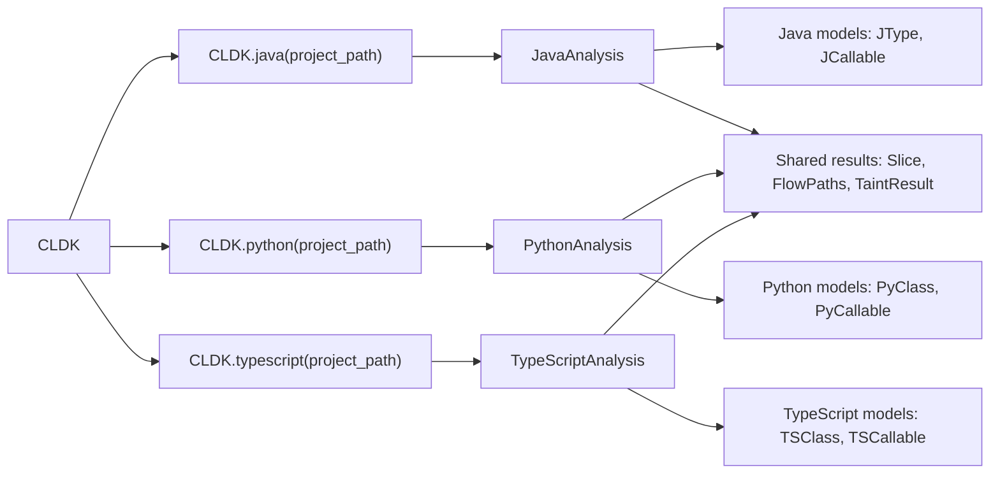

[](https://github.com/codellm-devkit/python-sdk)

`cldk` is the Python SDK of CLDK (CodeLLM-DevKit). It analyzes Java, Python and
TypeScript projects, and it gives you the results as typed Python objects.

There is one factory for each language: `CLDK.java(...)`, `CLDK.python(...)` and
`CLDK.typescript(...)`. A factory takes your project directory and returns an
analysis object. Then you call methods on that object, for example
`get_classes()` or `get_call_graph()`.

This page shows how the parts fit together, and which reference page documents
each part. For a first program, see the [Quickstart](/quickstart/). For an
introduction, see [What is CLDK?](/what-is-cldk/)

## Install

cldk 2.0.0 needs Python 3.11, 3.12, 3.13 or 3.14. It does not install on Python
3.15 yet. On Python 3.10 or older, pip stops with
`No matching distribution found`. On Python 3.14, pip compiles `tree-sitter`
from source, so you need a C compiler.
[Additional development tools](/installing/#additional-development-tools)
shows how to get one.

Install cldk in a virtual environment. To see the version of `python3`, run
`python3 --version`. If it is 3.11 to 3.14, run `python3 -m venv .venv`. If
not, make the virtual environment with a supported Python, for example
`python3.13 -m venv .venv`. On macOS and Linux, activate the virtual
environment with `source .venv/bin/activate`. Then run the line that you need:

```bash
pip install cldk             # Python and TypeScript analysis
pip install "cldk[java]"     # adds Java analysis
pip install "cldk[neo4j]"    # adds the Neo4j driver
pip install "cldk[all]"      # adds both extras
```

Keep the quotes around an extra, because zsh reads the brackets as a file
pattern. In a uv or Poetry project, use `uv add` or `poetry add` instead, for
example `uv add "cldk[java]"`.

If you run `CLDK.python(...)` from a virtual environment, set `SYSTEM_PYTHON`
first. This applies to an activated virtual environment, to `uv run` and to
`poetry run`. If you do not, the analysis can stop with a `RuntimeError`. In an
activated virtual environment on macOS or Linux, run this command:

```bash
export SYSTEM_PYTHON="$(python -c 'import sys; print(sys._base_executable)')"
```

For `uv run`, `poetry run` and Windows, see the Python Analysis tab in
[Language-specific dependencies](/installing/#language-specific-dependencies).
The Java Analysis tab lists the JDK and the build tool that Java call graphs
need.

## How the API fits together



Each factory returns an analysis object for its language: a `JavaAnalysis`, a
`PythonAnalysis` or a `TypeScriptAnalysis`. The symbol-table methods return
models of that language. For example, `get_classes()` returns a dictionary of
`JType` objects on Java, `PyClass` objects on Python and `TSClass` objects on
TypeScript. The slice, path and taint methods return result models that the
three languages share, for example a `Slice` from `slice_backward()`.

## Reference pages

| Page | What it documents |
| --- | --- |
| [Core (CLDK)](/reference/python-api/core/) | The `CLDK` class and its three factories, `AnalysisLevel`, and the backend configuration classes (for example `CodeAnalyzerConfig` and `Neo4jConnectionConfig`). |
| [Python analysis](/reference/python-api/python/) | `PythonAnalysis` and the Python models, for example `PyModule`, `PyClass` and `PyCallable`. |
| [Java analysis](/reference/python-api/java/) | `JavaAnalysis` and the Java models, for example `JCompilationUnit`, `JType` and `JCallable`. |
| [TypeScript analysis](/reference/python-api/typescript/) | `TypeScriptAnalysis` and the TypeScript models, for example `TSModule`, `TSClass` and `TSCallable`. This class also analyzes JavaScript projects. |
| [Results and errors](/reference/python-api/results/) | The result models that the query methods return (for example `Slice`, `FlowPaths` and `TaintResult`), the default bounds, and the exceptions. |
| [Tree-sitter utilities](/reference/python-api/treesitter/) | The tree-sitter parsers `TreesitterJava` and `TreesitterPython`, and the Java source sanitizer `TreesitterSanitizer`. |

The section of each analysis class lists all its methods in a table:
[`PythonAnalysis`](/reference/python-api/python/#pythonanalysis),
[`JavaAnalysis`](/reference/python-api/java/#javaanalysis) and
[`TypeScriptAnalysis`](/reference/python-api/typescript/#typescriptanalysis).

## Shared methods and language methods

In cldk 2.0.0, `JavaAnalysis`, `PythonAnalysis` and `TypeScriptAnalysis` share 54
methods with the same names. These methods cover the symbol table, the call
graph, dataflow, taint, entrypoints and non-code files, for example `pom.xml` and
`pyproject.toml`. The parameters of six of these methods are not the same on all
three classes, for example `get_callers()` and `get_call_graph()`.

The names that you pass and the models that you get back depend on the
language. The examples in this section come from cldk 2.0.0 on Commons CLI 1.7.0
and Flask 3.1.3.

A Java method signature uses fully qualified parameter types:
`create(java.lang.String)`, not `create(String)`. A short form matches nothing.
Some methods, for example `get_method()`, then return `None` or an empty result
with no error.

A Python name is a dotted path from `project_path`. In Flask, the class `Flask`
in `src/flask/app.py` is `src.flask.app.Flask`, not `flask.app.Flask`. Copy class
names from `get_classes()`. For a callable,
`resolve_callable("Flask.make_response").callable` gives the full name,
`src.flask.app.Flask.make_response`.

Some methods exist on one class only:

| Class | Methods only on this class, for example |
| --- | --- |
| `JavaAnalysis` | Comments and Javadoc (`get_comments_in_a_class()`, `get_comments_in_a_method()`, `get_all_comments()`), records (`get_records()`), compilation units (`get_compilation_units()`), test methods (`get_test_methods()`) and dispatches to view templates, for example JSP pages (`get_view_dispatches()`) |
| `TypeScriptAnalysis` | Decorators (`get_decorators()`), top-level functions (`get_functions()`), exports (`get_exports()`) and type aliases (`get_type_aliases()`) |
| `PythonAnalysis` | `get_python_file()` and `get_python_module()` |

`JavaAnalysis` and `TypeScriptAnalysis` also have some methods that
`PythonAnalysis` does not have, for example `get_interfaces()`, `get_enums()`
and `get_class_hierarchy()`.

## Analysis levels and known limits

At the default analysis level, `symbol_table`, the call-graph methods return
empty or partial results. The dataflow and taint methods raise an error. To use
these methods, pass a higher `analysis_level` to the factory:

- The call-graph methods, for example `get_call_graph()` and `get_callers()`,
  need `"call_graph"`.
- `get_cfg()`, `get_cdg()` and `get_ddg()` need `"program_dependency_graph"`.
- `resolve_value()`, `slice_backward()`, `slice_forward()`, `flows_to_call()`,
  `flows_to_argument()`, `paths_between()` and `taint()` need
  `"system_dependency_graph"`.

For example, use
`CLDK.python(project_path="flask", analysis_level="system_dependency_graph")`.
Each level includes the levels before it.
[Choose an analysis level](/reference/python-api/core/#choose-an-analysis-level)
lists the methods for each level.

If a method of the last group raises `SelectorNotInGraph`, make sure that the
analysis level is `system_dependency_graph`. A wrong name and a level that is
too low can give the same error. If you analyzed a TypeScript project before at
a lower level, also pass `eager=True` once.

:::caution[Python value flow across calls]
cldk 2.0.0 pins codeanalyzer-python 1.5.3. That version stops some value flow at
a call ([codeanalyzer-python#220](https://github.com/codellm-devkit/codeanalyzer-python/issues/220)).
codeanalyzer-python 1.5.4 fixes that defect, but it still stops a value at some
other calls. For example, in `sanitize(a) + sanitize(b)`, no query follows `b`
into `sanitize`. So on both versions, a negative Python result is not evidence
that no value flows. This applies to a `False` from `flows_to_call` or
`flows_to_argument`, an empty `paths_between` result and an `exhausted` pair
from `taint`.

After you install cldk, run `pip install "codeanalyzer-python==1.5.4"` to get
the 1.5.4 fix. pip reports the conflict with the pin in an `ERROR` line, and it
still installs 1.5.4. A later `pip install` of cldk or of a cldk extra puts
1.5.3 back. If you run one, run the 1.5.4 command again. For uv projects and the
details, see
[What the pinned Python backend does not link](/guides/system-dependence/#what-the-pinned-python-backend-does-not-link).
:::

## Next steps

- [Examples](/examples/): runnable programs for each language, grouped by task.
- [Core concepts](/guides/concepts/): what a static analysis can tell you, and
  the four levels of program facts.
- [Cheat sheet](/resources/cheatsheet/): the common calls on one page.
